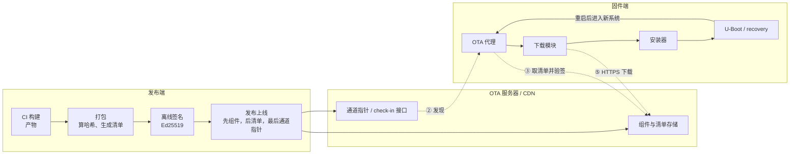
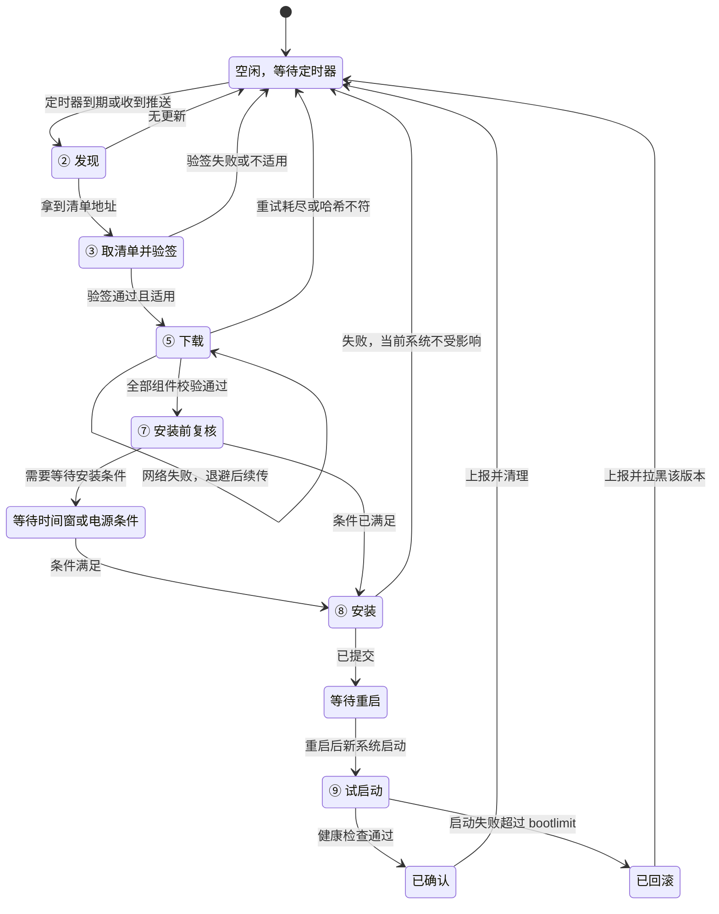
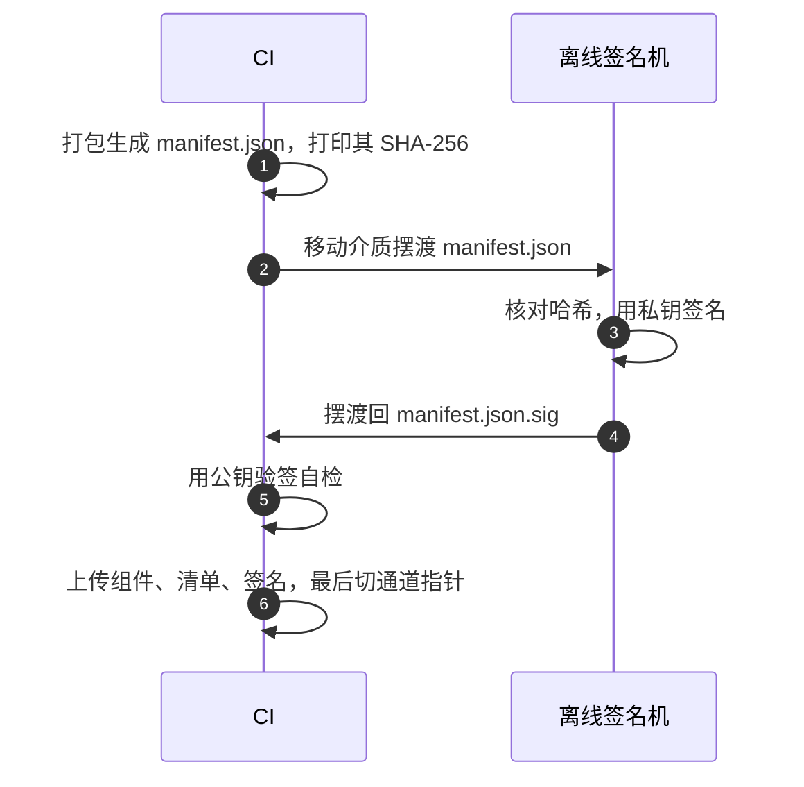
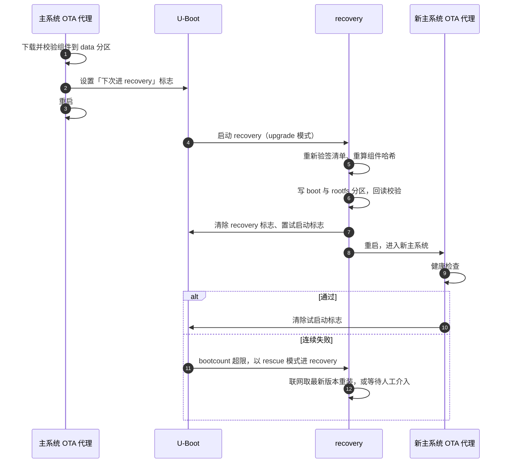

# OTA 标准作业书

> 本文是一套**可移植的 OTA（Over-The-Air）全流程作业书**：从发布端产物，到设备端完成升级、并在失败时自动回滚。适用于嵌入式 Linux 设备，以地平线 X3（ARM64）为参考平台。
>
> 文档只描述**方案、契约、判据和流程**，不绑定具体仓库、文件路径或实现代码。下载环节的参考实现见第 7 章。

## 目录

- 0. 目标、范围与信任模型
- 1. 总体流程
- 2. 发布端
- 3. 下载与订阅方案
- 4. 设备端流程
- 5. 测试与验证
- 6. 落地路线
- 7. 参考实现
- 附录：上游行为依据

---

## 0. 目标、范围与信任模型

### 0.1 目标

- 让设备能安全地拿到「一次构建、一份签名清单、一组组件」，并在校验通过后完成升级。
- 升级失败（坏包、坏固件、掉电、断网）**不导致变砖**，也不需要人工到场。
- 发布端一次构建的产物可被多台设备、多个环境（测试/生产/内网镜像）复用。
- 流程对发布端与设备端都是确定的：**同一份清单，两端行为唯一**。

### 0.2 范围边界

首版只升级**内核、设备树、根文件系统**三类组件。以下内容**不在 OTA 范围**，由出厂烧写固定：

| 不升级的内容 | 原因 |
|---|---|
| U-Boot 本体 | bootloader 损坏等于变砖，没有软件可以回滚。需要 SoC 级多镜像回退，或 A/B 两份 bootloader |
| 默认环境镜像 | 同上。运行时代理读写的环境变量是另一回事 |
| 分区表 | 改分区表可能让现有数据全部错位 |
| 启动脚本 `boot.scr` | 它是回滚逻辑的执行者，自身出问题时没有东西能回滚它 |
| recovery 分区本身 | 它是 recovery 方案的最后防线 |

这些内容的升级走单独流程：产线烧写，或日后设计带冗余的 bootloader 升级。

### 0.3 术语

| 术语 | 含义 |
|---|---|
| **发布清单**（release manifest） | 发布端生成并签名的 JSON，描述一个版本的全部信息：版本号、适用硬件、组件的哈希与地址、安装策略。设备端**只信这份文件** |
| **下载清单**（package manifest） | 下载器读取的简单配置，只描述「下载哪个文件、期望哈希是多少」。它是下载器的输入，不是信任来源 |
| **组件**（component） | 发布清单里的一个可下载文件：内核、dtb、rootfs |
| **暂存区**（staging） | 设备 data 分区上存放已下载、已校验组件的目录 |
| **槽**（slot） | A/B 方案中一套可以独立启动的 boot + rootfs 分区。运行中的叫**活动槽**，另一套叫**非活动槽** |
| **试启动**（trial boot） | 新固件已启动、但未通过健康检查的阶段 |
| **确认**（confirm） | 新固件通过健康检查后，代理清除试启动标志，该槽成为正式槽 |
| **设备端回滚** | 试启动失败时，U-Boot 自动切回旧槽（A/B）或进入 recovery（recovery 方案） |
| **服务端回滚** | 发布端把通道指针指回上一个版本 |
| **回滚攻击** | 攻击者让设备安装一个更旧、但签名有效的版本，由 `security_version` 阻止 |
| **通道**（channel） | `dev` / `beta` / `stable` 等发布通道，设备订阅其中一个 |

### 0.4 信任链

| 环节 | 保护什么 | 不保护什么 | 依赖 |
|---|---|---|---|
| TLS（传输层） | 传输管道：防窃听、防中间人替换流量 | 服务器被攻陷后下发恶意固件；旧版本重放 | 设备时钟正确、CA 证书包 |
| 发布清单签名（Ed25519） | 清单来自持有私钥的发布者，内容未被篡改 | 私钥泄露；旧清单被重放 | 设备内置公钥；私钥离线保管 |
| 组件 SHA-256 | 下载到的字节与清单一致 | 清单本身是否可信 | 清单已验签 |
| 防回滚（`security_version`） | 重放旧版已签名的清单 | 有 root 权限的攻击者改写存储的下限（要用 OTP/eFuse 才能防） | 下限存在 rootfs 之外 |
| 启动确认与设备端回滚 | 新固件启动失败导致变砖 | 新固件「能启动但逻辑错误」 | 健康检查覆盖关键功能 |
| Secure Boot（可选） | 设备不运行未签名的 bootloader 和内核 | — | SoC 支持、熔丝已烧录 |

> **顺序不能反。** 摘要只能证明「字节和清单一致」，清单本身必须先被证明可信：**先验签清单，再用清单里的哈希去下载**。下载模块本身不验签、也不做防回滚，这两项必须在下载前后补上。

### 0.5 威胁与对策

| 威胁 | 对策 | 所在步骤 |
|---|---|---|
| 传输被降级到明文、重定向到 HTTP | 只允许 HTTPS；证书和主机名校验不可关闭；最低 TLS 1.2 | ⑤ |
| 服务器或 CDN 被攻陷，下发篡改固件 | 发布清单签名 + 组件哈希 | ③ ⑥ |
| 服务器被攻陷，重放旧版清单 | `security_version` 单调递增 | ④ |
| 把别的型号的固件发给设备 | 硬件兼容 ID + 设备型号匹配 | ④ |
| 下载中断，半包被当成正式包 | 临时文件，校验通过才原子改名 | ⑤ ⑥ |
| 下载途中同一地址内容被替换 | 发布端保证地址不可变；最终哈希兜底 | 2.2、2.3、⑥ |
| 安装时掉电 | 只写非活动槽；写完再提交；状态存 U-Boot 冗余环境 | ⑧ |
| 新固件启动失败 | bootcount + 自动切回旧槽 / recovery | ⑨ |
| 设备时钟错误导致 TLS 校验失败 | 下载前检查时间同步 | ① |

---

## 1. 总体流程

### 1.1 端到端流程

### 1.2 设备端十步总览

固件端的步骤编号在全文通用：

| 步骤 | 名称 | 一句话说明 |
|---|---|---|
| ① | 前置检查 | 时间、网络、空间、电源都满足才开始 |
| ② | 设备发现 | 得到一个发布清单的地址，或者「没有更新」 |
| ③ | 获取发布清单并验签 | 只有验签通过的清单才被信任 |
| ④ | 适用性判断 | 这份清单是不是给这台设备的、是不是更新的版本 |
| ⑤ | 下载 | HTTPS 下载到暂存区 |
| ⑥ | 固件完整性校验 | SHA-256 与清单一致才发布为正式文件 |
| ⑦ | 安装前复核 | 再核对一遍，确认写的是非活动槽 |
| ⑧ | 安装 | 写入并提交 |
| ⑨ | 启动确认与自动回滚 | 新系统能用才算升级成功 |
| ⑩ | 上报与清理 | 把结果告诉服务端，清掉暂存区 |

### 1.3 设备端状态机

有三处迁移跨越了重启：`PendingReboot → TrialBoot`、`TrialBoot → RolledBack`，以及 `TrialBoot` 期间的断电。进程重启后内存状态丢失，这三处靠 **U-Boot 环境变量 + 设备端持久状态文件** 恢复，见 4.9。

---

## 2. 发布端

### 2.1 产物与版本

**需要的三个文件**（以 Buildroot 为例，构建完成后都在输出目录的 `images/` 下）：

| 组件 | 来源 | 说明 |
|---|---|---|
| 内核 | 内核包产物 `Image` | 保持不压缩，U-Boot 可直接加载 |
| 设备树 | `dtb` | 与内核一起放进 boot 槽 |
| 根文件系统 | `rootfs.squashfs` | squashfs 自带压缩，整分区写入 |

**为什么模块并入 rootfs**：内核和它的模块靠 vermagic 严格配对，必须同时更换；且 Buildroot 在内核开 `CONFIG_MODULES=y` 时会无条件把模块装进 rootfs。合并后，内核、dtb、rootfs 三者永远出自同一次构建。

**版本号怎么定**

| 字段 | 形式 | 例子 | 用途 |
|---|---|---|---|
| `version` | `主.次.修订` | `1.2.3` | 给人看，来自 git tag |
| `version_code` | 单调递增整数：主×10000 + 次×100 + 修订 | `10203` | 设备端比较新旧，免解析字符串 |
| `security_version` | 单调递增整数 | `5` | 防回滚 |
| `release_id` | 全部组件哈希列表的哈希，取前 12 位十六进制 | `9f2c1d7a4b6e` | 唯一标识一次构建，也是下载地址的一部分 |

三条规则：

- 已发布的 `version`、`version_code` 不能复用。改了任何一行代码，组件哈希变了，`release_id` 就变了，不会和旧包混在一起。
- `version_code` 由 CI 从 `version` 推导，不允许手工填写。
- CI 打包前检查新版本的 `version_code` 必须大于 stable 通道当前值，防止误发布「降级」版本。

### 2.2 打包契约

这是发布端与设备端安装器之间的契约：

| 发布文件名 | 是否压缩 | 设备端写入方式 |
|---|---|---|
| `Image` | 否 | 放进 boot 槽分区，按文件拷贝 |
| `<型号>.dtb` | 否 | 放进 boot 槽分区，按文件拷贝 |
| `rootfs.squashfs` | squashfs 自带压缩 | 整分区写入 |

- 文件名固定，不带版本号；版本只体现在目录名上，设备端安装逻辑不用解析文件名。
- **散件而不是 tar 包**：与「一个清单下载一个文件」一一对应；每个组件可单独续传；内核没变时可跳过；设备端不必为解包再腾一份空间。
- **不再压缩**：squashfs 本身已压缩；内核保持不压缩便于 U-Boot 加载。需要 `Image.gz` 的板子在构建阶段压缩，OTA 流程不变。

**目录布局契约**。打包工具应产出一个只读发布目录，结构固定：

- `releases/<型号>/<版本>/<release_id>/manifest.json`
- `releases/<型号>/<版本>/<release_id>/manifest.json.sig`
- `releases/<型号>/<版本>/<release_id>/files/` 下放各组件

`release_id` 参与路径，保证**同一地址的内容永远不变**（见 2.3 的地址不可变原则）。

### 2.3 发布清单（契约规范）

**顶层字段**

| 字段 | 类型 | 必填 | 含义 |
|---|---|---|---|
| `schema_version` | 整数 | 是 | 清单格式版本。设备不认识的主版本直接拒绝 |
| `release_id` | 字符串 | 是 | 本次构建唯一标识，也是下载地址的一部分 |
| `version` | 字符串 | 是 | 人读版本号 |
| `version_code` | 整数 | 是 | 与 `version` 对应的单调整数 |
| `security_version` | 整数 | 是 | 防回滚计数，只会增加 |
| `model` | 字符串 | 是 | 目标设备型号 |
| `hardware_compat` | 字符串数组 | 是 | 兼容的硬件 ID 列表，对应设备树 `compatible` |
| `min_version_code` | 整数 | 否 | 安装本包要求的最低当前版本，缺省 0（不限制） |
| `created_at` | 字符串 | 是 | 清单生成时间，UTC |
| `install` | 对象 | 是 | 安装策略 |
| `components` | 对象数组 | 是 | 组件列表 |

**`install` 安装策略**

| 字段 | 类型 | 必填 | 含义 |
|---|---|---|---|
| `mode` | 字符串 | 是 | `download-only` 只下载不安装；`reboot-required` 装好后重启；`immediate` 装好立即重启（无人值守） |
| `window` | 字符串 | 否 | 允许重启的时间窗，如 `"02:00-05:00"`，设备本地时间。检查和下载不受限 |
| `reboot_delay_seconds` | 整数 | 否 | 安装完成后延迟多久重启，给应用保存状态留时间 |
| `layouts` | 字符串数组 | 是 | 本包支持的分区布局：`"ab"`、`"recovery"`，或两者 |

**`components[]` 组件**

| 字段 | 类型 | 含义 |
|---|---|---|
| `name` | 字符串 | 组件名：`kernel`、`dtb`、`rootfs`。安装器按它决定怎么写 |
| `path` | 字符串 | 组件在 OTA 服务器上的路径，**相对服务器根目录** |
| `sha256` | 字符串 | 组件的 SHA-256，小写十六进制，64 位 |
| `size` | 整数 | 组件的字节数 |
| `target` | 字符串 | 写入目标：`boot`（按文件拷贝）或 `rootfs`（整分区写入） |

**设计要点**

- **`path` 用相对路径，不用完整 URL。** 设备端用自己配置的服务器地址拼出完整地址。同一份签名清单可以放在任何域名下（测试/生产/内网镜像），不需要为每个环境重新签名。拼出的地址仍要经 HTTPS 校验。
- **`min_version_code` 与 `security_version` 是两件事。** 前者是「升级路径」（不允许跳过中间版本），后者是「防回滚」（拒绝旧清单）。混成一个字段就无法正确判断。

  | 设备状态 | 判定 | 结果 |
  |---|---|---|
  | 清单 `security_version` < 设备记录的下限 | 回滚攻击，或通道指错 | 拒绝，不下载 |
  | 设备 `version_code` < 清单 `min_version_code` | 升级路径不允许 | 拒绝，上报「需要中间版本」 |
  | 清单 `version_code` ≤ 设备 `version_code` | 已经是这个版本或更新 | 忽略 |
  | 其余 | 正常升级 | 继续 |

- **地址不可变。** 路径里带版本号和 `release_id`，服务器上这个目录一经发布就不再修改。否则同一个地址的内容变了，断点续传会把新旧两段拼成一个坏包（最终哈希能拦住坏包，但整个文件要白下载一遍）。
- **格式兼容。** 新增字段不必提高 `schema_version`，旧设备忽略不认识的字段。只有改变已有字段含义时才提高主版本号。

### 2.4 签名与密钥管理

用**离线保管的私钥**对清单签名，签名覆盖的是清单的**原始字节**（不是解析后的内容），因此清单一旦签名就不能再改，包括改一个空格。

**为什么签清单而不是签镜像**：清单一小（几 KB），验签极快；一份签名保护了包内所有文件；镜像体积大、逐个签名成本高。

**算法选择：Ed25519**。约 128 位安全强度；签名确定性、不依赖随机数（避免 ECDSA 类随机数缺陷导致私钥泄露）；签名仅 64 字节、公钥仅 32 字节，传输和验证都轻。

**操作要点**

1. 在完全离线的机器上生成 Ed25519 密钥对；私钥加口令保护，绝不联网。
2. CI 生成未签名的 `manifest.json`，用移动介质摆渡到离线机。
3. 离线机核对清单哈希后签名，产出独立的 `manifest.json.sig`（64 字节），清单本身原样不动。
4. 摆渡回 CI，CI 用公钥验签自检后才能发布。
5. 把公钥（32 字节原始形式）编译进设备固件，设备端只信任内置公钥。

**密钥去处**

| 密钥 | 去处 | 用途 |
|---|---|---|
| 私钥 | 只留离线机；离线介质两份、异地存放 | 签名 |
| 公钥（PEM） | CI、运维留存 | 上传前自检、人工核对 |
| 公钥（32 字节原始） | 固件源码，编译进设备 | 设备端验签 |

**密钥管理**

- 私钥加口令，口令与备份介质分开保管。Ed25519 签名确定性，同一私钥对同一清单只产生一个签名，可据此确认 `.sig` 确实出自该私钥。
- **轮换顺序不能反**：设备先持有新公钥，才能接受新私钥的签名。顺序：生成新密钥对 → 发一版带新旧两把公钥、仍用旧私钥签 → 设备都升级后 → 改用新私钥签 → 再发一版删掉旧公钥。
- 私钥泄露时：立即生成新密钥对，用新私钥签发 `security_version` 更高的版本并在其中带上新公钥；只信任旧公钥的设备仍脆弱，只能尽快升级。
- 想提高效率可用硬件密钥（YubiKey/HSM），私钥不可导出，属可选演进。

**签名流程**

**设备端验签**：用内置可信公钥（可多把，支持轮换）对清单原始字节做 Ed25519 验签；签名长度必须是 64 字节；验签通过**之后**才解析 JSON。Ed25519 有两个常见坑：摘要参数必须为空（Ed25519 不经过摘要），且只能「一次喂完」，不能分块 Update。参考实现见第 7 章。

### 2.5 发布上线与回滚

**上传顺序**（顺序错了不会损坏设备，但会白失败一轮）：

1. 上传 `files/` 下全部组件到 `releases/<型号>/<版本>/<release_id>/files/`。对象存储按 key 写入是原子的；普通文件服务器先传成临时名再 `mv`。
2. 上传 `manifest.json` 和 `manifest.json.sig`。
3. 自检：从外网地址重新下载清单和签名，用公钥验签；抽查一个组件的哈希。
4. **最后**才切换通道指针（静态方案是覆盖 `channels/<通道>/<型号>/` 下的清单副本和签名；API 方案是启用一个 deployment）。指针切换前，设备看不到这次发布。
5. 观察设备上报结果（失败率、回滚率），再决定是否扩大范围。

> 为什么顺序重要：设备取到清单后会立刻按 `path` 下载。清单先于组件可见，设备会收到 404。

**服务器目录约定**

- `releases/<型号>/<版本>/<release_id>/`：组件、清单、签名，发布后只读。
- `channels/<通道>/<型号>/`：通道指针，是某个发布清单的副本。

**CDN / 服务端配置要点**

| 配置项 | 组件（`releases/`） | 通道指针（`channels/`） |
|---|---|---|
| `Cache-Control` | `public, max-age=31536000, immutable` | `no-cache` |
| HTTP Range | 必须支持，返回 `206 Partial Content` | 不要求 |
| 协议 | 全程 HTTPS | 全程 HTTPS |
| `ETag` | 可选 | 建议，设备用它做条件请求 |

- 断点续传依赖 Range：续传时服务器返回 206，否则回退整包下载。
- 全程必须 HTTPS：CDN 若把请求重定向到 HTTP 预签名地址，下载会以协议/TLS 错误失败。
- 组件地址不可变，无需刷新 CDN；通道指针被覆盖后要刷新或等过期。

**通道与灰度**：`dev`（开发自测）、`beta`（小批量验证）、`stable`（正式）。静态方案只能按通道推进；API 方案可按设备分组或百分比放开。

**服务端回滚**：发现新版本有问题时，把通道指针指回上一版本。这只影响**还没升级**的设备。已升级设备不会「被指回去」（版本号已更高）——要让它们恢复，需发一个版本号更高的包，内容是上一版代码；`security_version` 只能不变或提高。**版本号只增不减**是基本约束。

**历史版本保留**：至少保留最近 5 个版本及任何通道指针引用的版本；长期离线设备需要的中间版本不能删；先切指针、后删文件。

### 2.6 可复现构建（可选）

打开可复现构建选项后，同一源码与配置产出逐字节相同的文件，哈希与 `release_id` 也相同，「这次构建变没变」可直接用哈希回答。它不是正确性前提：无论构建出什么，哈希都对实际产物计算、清单也对它签名。Buildroot 标其为实验性，且要求两次构建使用相同输出目录。

---

## 3. 下载与订阅方案

「订阅」要解决两个问题：设备怎么知道有新固件；设备拿到的是不是给自己的那一份。

无论哪种订阅形态，② 的输出都是同一个：**一个发布清单的地址，或者「没有更新」**。之后 ③–⑩ 完全一致，所以形态可互换，差别只在 ② 这一步。

### 3.1 四种订阅形态

**形态 A：轮询静态清单。** 服务端只有静态文件；设备配置里存服务器地址、型号、通道。设备按周期 `GET` 通道下的清单，带 `If-None-Match`（ETag）做条件请求，304 即无变化；200 则再取签名、进入 ③。灰度只能按通道推进。局限：服务端不知道设备状态，不能定点升级。

**形态 B：轮询 API（check-in）。** 设备 `POST` 上报自身状态（型号、当前版本、`security_version`、布局、槽），服务端返回「无更新」（204）或「目标清单地址 + 下次轮询间隔」。可做按设备/分组/百分比的灰度，以及上报通道。鉴权可用无鉴权（仅 TLS）、设备令牌或双向 TLS。

**形态 C：MQTT 推送。** 广播 topic + 点对点 topic；通知只「叫一声」，不带清单内容、不带固件；设备收到后照常走 ③。用 retained 消息、固定 `client_id`、关闭 clean session，断线重连靠轮询兜底。

**形态 D：轮询 + 推送并存。** 长连接负责快，轮询负责稳；两条路径最终调用同一个入口（给定一个清单地址，开始 ③）。

### 3.2 对比

| 维度 | A 轮询静态清单 | B 轮询 API | C MQTT 推送 | D 轮询 + 推送 |
|---|---|---|---|---|
| 新版本到达延迟 | 一个轮询周期 | 一个轮询周期 | 秒级 | 秒级（连接正常时） |
| 服务端复杂度 | 最低，只有静态文件 | 中：设备注册、鉴权、deployment 管理 | 中到高：Broker、鉴权、topic 授权 | 高，两者都要 |
| 设备端依赖 | 无，复用 HTTPS 栈 | HTTP 客户端，需支持 POST | MQTT 客户端库，长连接 | 两者都有 |
| 设备资源占用 | 低 | 低 | 常驻连接、心跳、重连 | 较高 |
| NAT 与弱网 | 友好 | 友好 | 长连接易被 NAT 断开，需 keepalive/重连 | 轮询兜底 |
| 灰度控制 | 只能按通道，粗 | 细：按设备、分组、百分比 | 点对点可定向 | 细 |
| 可观测性 | 无 | 强：check-in + 上报 | 中：在线状态、上报 | 强 |
| 离线设备与私有化 | 最好：可镜像、可离线导入 | 需部署服务端 | 需部署 Broker | 两者都要 |
| 适用场景 | 小批量、内网、试点 | 中大规模产品 | 时效敏感、需远程干预 | 大规模且要求低时延 |

### 3.3 推荐演进

1. **先做 A。** 服务端零开发，就能把打包、签名、下载、安装、回滚整条链路跑通。
2. **需要看设备状态/灰度时升级到 B。** 设备端只改 ②（多一个 POST），下载、安装、回滚不动。
3. **有低时延要求再加 C**，变成 D。

把 ② 的输出固定成「一个清单地址」，替换订阅方式的代价就被限制在 ② 内部。

### 3.4 轮询策略

| 参数 | 建议值 | 说明 |
|---|---|---|
| 基础间隔 | `stable` 6 小时，`beta` 15 分钟，`dev` 5 分钟 | API 方案由服务端通过 `poll_after_seconds` 下发 |
| 随机抖动 | 间隔的 ±20% | 避免所有设备同一时刻请求 |
| 失败退避 | 1→2→4→…小时，24 小时封顶 | 网络错误、5xx、TLS 失败 |
| 收到推送后的延迟 | 0–60 秒随机 | 避免惊群 |
| 已评估过的清单 | 本地记 `release_id` | 不重复评估，除非是新出现的 |

检查与下载随时可做，不受安装时间窗限制；`install.window` 只约束「重启」这一个动作。

### 3.5 设备侧适用性筛选

按顺序逐项检查，任何一项不通过就停止、不下载：

| 顺序 | 检查 | 不通过时的含义 |
|---|---|---|
| 1 | `model` 与设备型号一致 | 发错对象 |
| 2 | `hardware_compat` 与设备 `compatible` 列表有任意一项相同 | 硬件不兼容 |
| 3 | `install.layouts` 包含本机分区布局 | 安装器不认识这种布局 |
| 4 | 清单 `security_version` ≥ 设备记录下限 | 回滚攻击，或通道指错 |
| 5 | 设备 `version_code` ≥ 清单 `min_version_code`（缺省 0） | 需要先升中间版本 |
| 6 | 清单 `version_code` > 设备 `version_code` | 已经是这个版本或更新 |
| 7 | 该 `release_id` 不在本机拉黑列表 | 之前装过并触发了回滚 |

第 2 项数据来自设备树：`compatible` 是 NUL 分隔的字符串列表。第 4 项的下限存在 **U-Boot 环境变量**（而非 rootfs），因为两种方案都会替换 rootfs，而 U-Boot 环境在升级前后一直有效；代理读取它、只在新值更大时提高。

---

## 4. 设备端流程

### 4.1 ① 前置检查

| 检查项 | 判定方法 | 不通过时 |
|---|---|---|
| 系统时间 | 当前时间晚于固件构建时间，且 NTP 已同步 | 等待；超阈值上报 |
| 网络 | 接口已启动、有默认路由、域名可解析 | 按退避重试 |
| 存储空间 | 暂存区可用 ≥ 各组件 `size` 之和 + 余量 | 清理旧暂存；仍不够则上报放弃 |
| 电源 | 有电池的设备：电量高于阈值或正在充电 | 推迟 |
| 当前状态 | 不在试启动中，没有未完成的安装 | 等待 |

> **时间检查为什么第一。** TLS 校验证书有效期依赖系统时钟。没有电池备份 RTC 的设备刚上电可能停在 1970 年，此时 HTTPS 必然校验失败。可靠做法：把固件构建时间编进程序，启动时若时钟早于它，先拨到构建时间，再等 NTP 同步。

### 4.2 ② 设备发现

四种订阅形态见第 3 章。输出只有两种：一个发布清单地址，或「没有更新」。

### 4.3 ③ 获取发布清单并验签

**处理顺序**

1. 下载 `manifest.json` 到临时文件。
2. 下载 `manifest.json.sig`（签名固定 64 字节，多一个都不要）。
3. 用内置公钥表验签，对象是清单的**原始字节**。
4. 验签通过**之后**才解析 JSON：校验字段类型与取值范围，拒绝不认识的主版本。
5. 把清单和签名存进暂存目录（重启或进入 recovery 后还要用）。

**失败处理**

| 现象 | 处理 |
|---|---|
| HTTP 404 | 通道指针指向的清单不存在，发布出错。不重试，下周期再看 |
| 签名不是 64 字节，或验签失败 | **不下载任何组件**；上报告警，记下 `release_id`，本周期不再尝试 |
| JSON 解析失败 | 验签通过但格式不对，发布端工具 bug。同上 |
| `schema_version` 不支持 | 设备太旧。同上 |
| 网络、TLS 错误 | 按 3.4 退避重试 |

### 4.4 ④ 适用性判断

规则见 3.5，按序逐项检查。全部通过后代理做两件事：

1. **提高防回滚下限**（U-Boot 环境变量，只在新值更大时写）。
2. **确定后续行为**：`download-only` 在 ⑥ 之后停下等用户确认；`reboot-required` / `immediate` 继续。

> 下限在安装前就提高，而不是等确认之后：即使新固件后来被回滚，旧固件也带着新下限，这台设备从此不再接受更旧的清单。

### 4.5 ⑤ 安全下载

下载模块负责把组件安全地落到暂存区，保护的是「传输管道」：

- 只允许 HTTPS；拒绝带用户信息的 URL；证书与主机名校验不可关闭，最低 TLS 1.2。
- 重定向逐跳校验，只跟 HTTPS，默认最多 5 次。
- 禁止透明解压，保证摘要针对原始字节。
- 先写同目录临时文件，`fflush` + `fsync` 后再算摘要；摘要一致才原子改名发布，并去掉可执行位。
- 摘要不一致时删除临时文件，不留下可被误装的包。
- 同一个临时文件只允许一个进程写（文件锁）。
- 支持断点续传；服务器不支持 Range 时自动回退整包下载。
- 体积上限、声明大小校验、低速保护（低于阈值持续一段时间即中止）、连接/传输超时。
- 错误分类清晰（参数、IO、网络、TLS、HTTP、协议、体积、校验和不符、Range 不支持），便于代理决定重试还是放弃。

**参考实现**：下载模块的完整实现、参数和退出码见 [firmware_secure_download](https://github.com/guoyulong1/firmware_secure_download)。该模块只负责安全传输与完整性校验，不验证发布者签名、不做防回滚——这两项由 ③ 和 ④ 在调用它之前完成。

**暂存区约定**：暂存目录放在 data 分区（不参与升级），按 `release_id` 分目录，每个版本一个目录。下载中的临时文件按目标路径命名（追加 `.part`），因此同目录只属于一个版本，残留临时文件不可能串到别的版本。

**下载前的本地判断**：目标文件已存在时，下载器默认拒绝覆盖。代理应先用哈希判断：已存在且哈希等于清单值 → 跳过（上次已下完，可能安装前断了电）；存在但哈希不符 → 删除重下；不存在 → 下载。

**重试策略**：只对网络类错误重试。

| 第几次重试 | 等待 |
|---|---|
| 1 | 1 分钟 |
| 2 | 5 分钟 |
| 3 | 15 分钟 |
| 4–8 | 30 分钟 |
| 用尽 | 放弃，等下个发现周期；连续 3 个周期用尽后上报 `failed` |

**错误码 → 代理动作**（关键几种）：参数/清单不合法 → 不重试、上报；IO → 查空间/挂载，清理后重试一次；网络 → 退避续传；TLS → 不重试、告警（查时钟与 CA）；HTTP 4xx → 不重试、重新走 ②；5xx → 退避；协议/体积 → 不重试、告警；校验和不符 → 临时文件已删，最多重试 2 次防 CDN 坏块，连续不符则告警放弃；Range 不支持 → 内部已回退整包，通常看不到。

全部组件下载完成后执行一次 `sync`（下载器改名后对目录项是否落盘只告警不报错，`sync` 补上这个窗口）。

### 4.6 ⑥ 固件完整性校验

下载器在 `fflush` + `fsync` 之后对临时文件整个文件计算 SHA-256，与清单 `expected_sha256` 比较，一致才改名为正式文件。所以 ⑤ 结束即 ⑥ 完成。

这一步证明：暂存区里的文件与已验签清单记录的哈希完全一致。加上 ③ 的验签，信任链闭合：私钥持有者签了清单 → 清单记录哈希 → 下载字节匹配哈希。

**只用 SHA-256，不用 MD5**：MD5 碰撞早已实用化，签名的清单里也只放 SHA-256；下载器接受 MD5 仅为兼容，OTA 代理应把 MD5 留空。

**安装后还会再校验一次**（写入分区后回读），两次校验防的是不同错误：下载校验保「暂存区文件」，回读校验保「写进 Flash 的内容」。

### 4.7 ⑦ 安装前复核

1. **重算暂存文件哈希**：下载与安装之间若发生重启，文件可能因断电损坏；再读一遍代价很小。
2. **确认写入目标**：A/B 方案里写入目标必须是非活动槽。这是安装器最重要的一条断言：**正在运行的槽，升级全程一个字节都不能动**。
3. **确认容量**：目标分区容量大于组件 `size`。
4. **确认安装条件**：`install.mode`、`install.window`、电源条件。
5. **通知应用**：进入「即将升级」状态，停止写入关键数据、保存状态、点灯或界面提示。

### 4.8 ⑧ 安装

两套方案的 ①–⑦ 完全相同，差别从这里开始。设备出厂时已确定分区布局，代理只接受 `install.layouts` 包含这种布局的清单（3.5 第 3 项）。

#### 方案一：A/B 双分区

**分区表**（GPT，分区 UUID 建表时固定；启动参数用 `PARTUUID` 指定根分区，不用设备名，避免 eMMC/SD 编号互换）：

| 分区 | 名称 | 内容 | 容量示例 | 随 OTA 变化 |
|---|---|---|---|---|
| 1 | `uboot` | U-Boot、`boot.scr`、冗余环境 | 64 MiB | 否 |
| 2 | `boot_a` | 内核、dtb | 64 MiB | 是 |
| 3 | `boot_b` | 内核、dtb | 64 MiB | 是 |
| 4 | `rootfs_a` | rootfs 整镜像 | 512 MiB | 是 |
| 5 | `rootfs_b` | rootfs 整镜像 | 512 MiB | 是 |
| 6 | `data` | 用户数据、OTA 暂存 | 剩余空间 | 否 |

rootfs 是只读 squashfs，运行期不会因掉电损坏；可写数据全放 data 分区。

**安装步骤**（设运行在 A 槽，目标 B 槽）：

1. 写 rootfs 分区：整分区写入，然后**回读校验**（只读镜像长度那么多字节，分区多出的部分不比较）。
2. 写 boot 槽分区：格式化后按文件拷贝内核与 dtb，校验哈希，`sync` 并卸载。
3. `sync`，确保 data 分区文件落盘。
4. 写持久状态文件：记为待重启，带上 `release_id` 与目标槽。
5. **提交**：一条命令同时改三个 U-Boot 环境变量（启动槽、试启动标志、启动计数）。
6. 重启：按 `install.mode` 执行；`immediate` 加延迟，`reboot-required` 还要等时间窗。

**要点**

- **提交点只有一个**（第 5 步）。之前掉电，环境变量没变，设备照常从旧槽启动；之后掉电，从新槽启动、进入试启动。两种结果都能从环境变量识别，因为环境变量是唯一真值来源。
- **三条赋值写在一个命令里**：`fw_setenv` 一次写整个环境，不会出现「只改了一半」的中间状态（前提：U-Boot 环境做了冗余，见 4.12）。
- **状态文件只是辅助**：它先于提交点写入；若在写它和提交之间掉电，重启后代理发现「状态说待重启、但环境变量没变」，就重做一次提交（提交幂等）。
- **安装失败不影响当前系统**：写入/校验失败时清理非活动槽状态、上报失败，设备继续用旧槽运行。

**变体**：boot 槽用 FAT 则把格式化换成 `mkfs.vfat`；把 boot 槽做成整镜像则内核与 dtb 合并为一个组件，按整分区写入 + 回读校验（代价是内核没变时不能单独跳过）。

#### 方案二：单系统 + recovery

**分区表**

| 分区 | 名称 | 内容 | 容量示例 | 随 OTA 变化 |
|---|---|---|---|---|
| 1 | `uboot` | U-Boot、`boot.scr`、冗余环境 | 64 MiB | 否 |
| 2 | `boot` | 主系统内核、dtb | 64 MiB | 是 |
| 3 | `recovery` | recovery 内核（内置 initramfs）、dtb | 64 MiB | 否 |
| 4 | `rootfs` | rootfs 整镜像 | 512 MiB | 是 |
| 5 | `data` | 用户数据、OTA 暂存 | 剩余空间 | 否 |

**recovery 镜像构成**：用第二个根文件系统配置构建（输出目录与主系统分开），产物是内置 initramfs 的内核；只放几样东西——busybox、`fw_setenv` 工具、boot 分区的文件系统工具、与主系统同一套静态链接的 OTA 校验/安装程序；入口是 `/init`。

**升级流程**

**A. 主系统内**：①–⑥ 同方案一；`sync`；写状态文件（待 recovery，带 `release_id`）；提交（设置 recovery 标志）；重启。

**B. U-Boot**：看到 recovery 标志，启动 recovery 分区内核。

**C. recovery**：挂载 `/proc`/`/sys`/`/dev`，等 mmc 设备；读写挂载 data；读状态文件找暂存目录；**重新验签清单、重算每个组件哈希、重做 ④ 全部检查**（recovery 以最高权限写系统分区，不能假设主系统已检查过）；写 boot 分区（格式化、拷贝、比对、`sync`、卸载）；写 rootfs 分区并回读校验；成功则清标志、置试启动、写结果、重启；失败则不动标志、失败计数+1、重启，U-Boot 再进 recovery 重试。

**D. 新主系统**：试启动标志为 1，健康检查、确认、上报同方案一（4.9）。

**rescue 模式**：recovery 有两种模式——`upgrade`（代理触发，装暂存区里的版本）与 `rescue`（recovery 连续失败 3 次或新系统连续启动失败超限，停在 recovery，联网取最新版本重装，或等待人工介入，用指示灯提示）。rescue 需联网下载，所以 recovery 里的 OTA 程序需同时具备下载、验签、安装三种能力（静态链接即可）。

> 主系统已不完整且设备无网络时，唯一办法是保留一份「上一个确认过的版本」的暂存副本，让 rescue 离线恢复；代价是 data 分区多占一套组件。

**两套方案对比**

| 维度 | A/B 双分区 | 单系统 + recovery |
|---|---|---|
| Flash 占用 | 高：boot 和 rootfs 各两份 + 暂存 | 低：一份主系统 + 小 recovery + 暂存 |
| 升级期间可用性 | 不中断，只在切换时重启一次 | 中断，写主系统期间设备不可用几分钟 |
| 新固件启动失败后 | 自动切回旧槽，几分钟恢复 | 只能进 recovery 重装，旧系统已被覆盖 |
| 回滚含义 | 真回滚（回到旧固件） | 重装（同版本再装或装另一版本） |
| 掉电安全 | 好，活动槽全程不动 | 写主系统时掉电，主系统不完整，必须靠 recovery |
| 暂存区 | 必须有一份 | 必须有一份，且是恢复时唯一数据来源 |
| 适用场景 | 7×24 运行、无人值守、要求自愈 | Flash 小、可接受升级停机、成本敏感 |

Flash 预算示例（rootfs 300 MiB、boot 64 MiB）：A/B ≈ 300×2 + 64×2 + 300 ≈ 1.0 GB；recovery ≈ 300 + 64 + 64 + 300 ≈ 730 MiB。

### 4.9 ⑨ 启动确认与自动回滚

**U-Boot 环境变量**

| 变量 | 含义 | 谁写 |
|---|---|---|
| `bootslot`（方案一） | 这次启动哪个槽 | 代理安装结束时；`boot.scr` 回滚时 |
| `ota_recovery`（方案二） | 1 表示下次进 recovery | 代理；recovery；`boot.scr` |
| `recovery_mode`（方案二） | `upgrade` 或 `rescue` | `boot.scr` |
| `upgrade_available` | 1 表示当前是尚未确认的新固件 | 代理；recovery；`boot.scr` |
| `bootcount` | 试启动期间连续启动次数 | `boot.scr` |
| `bootlimit` | 允许的最大试启动次数 | 出厂写入，OTA 不改 |

所有标志只用 0/1 赋值，不用「删除变量」的写法。

**计数逻辑（要点）**：`boot.scr` 每次执行时——补默认值；**只在试启动期间（`upgrade_available=1`）计数**：先加一并保存，再启动，这样本次启动中掉电计数也已落盘；若计数超 `bootlimit` 则切换槽/进入 rescue、清试启动标志、计数归零、保存；最后按槽名/标志加载内核与 dtb 并启动；脚本末尾的复位兜底「加载失败」。`bootlimit=3` 时新固件有 3 次完整启动机会，第 4 次回滚。

> 为什么在启动脚本里计数、而不用 U-Boot 自带的 bootcount 机制：自带机制每次启动都计数，正常运行中反复断电累积到上限也会触发切换，所以必须自己判断「现在有没有升级在进行」。放在启动脚本里并用试启动标志门控，正常运行中完全不计数、也不擦写环境。两者选其一，不要混用。

**启动失败必须表现为一次重启**：计数只在启动脚本执行时加一，所以回滚能触发的前提是——新固件的每一种失败最终都变成一次重启。

| 失败形态 | 默认行为 | 需要的配置 |
|---|---|---|
| 内核 panic | 停住不动 | 启动参数加 `panic=10`，10 秒后自动重启 |
| 内核启动后挂死/init 失败 | 停住不动 | 硬件看门狗 |
| 系统起来了但应用起不来 | 一直运行 | 健康检查门控的看门狗，或确认期限 |
| 内核镜像损坏，加载失败 | 回到启动脚本 | 脚本末尾的复位 |
| U-Boot 自身挂死 | 无解 | 硬件看门狗（U-Boot 不在 OTA 范围） |

推荐做法：**试启动期间只有健康检查全部通过后代理才开始喂狗**，任何「起不来」都会在看门狗超时后变成一次复位，`bootcount` 随加一。没有看门狗的设备用**确认期限**代替（试启动开始后一段时间内未通过健康检查，代理主动重启且不确认）。

**健康检查**：依据「这台设备能干它该干的活」，常见项——根分区只读挂载成功且关键目录存在；主应用运行且连续一段时间无崩溃重启；网络连通且能完成一次 check-in；外设自检通过；没有未处理的严重错误日志。

**确认动作**：健康检查通过后清除试启动标志与计数。从这一刻起新槽成为正式槽；代理上报 `confirmed`，清理暂存区，更新状态文件。

**回滚之后代理做什么**：旧系统里的代理发现「状态文件记着待确认版本，但自己运行的不是它，且试启动标志为 0」→ 说明发生回滚：① 上报 `rolled_back`；② 把该 `release_id` 写入本机拉黑列表（否则会「下载→安装→失败→回滚→又发现→再装」死循环）；③ 清理非活动槽与暂存区；④ 继续正常轮询，直到出现更新版本或运维远程清除拉黑。

> 试启动窗口内反复断电也可能让一个正常固件被回滚。这是有意的取舍：宁可多回滚一次，也不能让设备卡在坏固件里。

### 4.10 ⑩ 上报与清理

**上报事件**：`checking`（每次发现，带当前版本）、`downloading`（按进度间隔，带 `release_id` 和百分比）、`downloaded`（⑥ 通过）、`pending_reboot`（提交后，带目标槽）、`confirmed`（确认后，带前后版本）、`failed`（任何一步失败，带失败步骤与错误码）、`rolled_back`（回滚后，带目标版本）。

上报失败不影响升级本身，排队到下次在线补发。静态方案无上报通道，事件只写日志或走设备自有运维通道。

**清理时机**：确认后删暂存目录（A/B 非活动槽保留旧固件，不动）；回滚后删暂存并清理非活动槽；开始新下载前删其他版本的暂存腾空间；每次启动检查残留临时文件——属于当前待处理版本的留着续传，其余删除。

### 4.11 掉电与异常矩阵

**方案一：A/B**

| 阶段 | 掉电或失败时状态 | 下次启动 | 代理动作 |
|---|---|---|---|
| 下载中 | 暂存区留着临时文件或无 | 旧槽，正常 | 续传或重下 |
| 写非活动槽 | 非活动槽不完整，环境变量没变 | 旧槽，正常 | 丢弃这次安装，从暂存重装 |
| 写状态文件后、提交前 | 环境变量没变 | 旧槽，正常 | 重做提交 |
| 提交时 | 冗余环境保证至少一份有效 | 新槽或旧槽 | 两种结果都能从环境变量识别 |
| 试启动中 | 计数已加并保存 | 新槽，继续试启动 | 累积，超限自动切回 |
| 试启动失败超限 | — | 旧槽，脚本已切回 | 上报 `rolled_back`，拉黑该版本 |
| 确认之后 | — | 新槽是正式槽 | 上报 `confirmed`，清理暂存 |

**方案二：单系统 + recovery**

| 阶段 | 掉电或失败时状态 | 下次启动 | 处理 |
|---|---|---|---|
| 下载中 | 暂存留着临时文件 | 主系统，没动过 | 续传 |
| 提交之后 | recovery 标志为 1 | recovery | 正常升级流程 |
| recovery 写主系统时 | 主系统不完整，标志仍为 1 | recovery | 从暂存重装（暂存不受影响） |
| recovery 校验/写入失败 | 同上 | recovery | 失败计数+1，达 3 次转 rescue |
| recovery 成功改环境变量时 | 标志可能是 0 或 1 | 主系统（试启动）或 recovery | recovery 重做一遍幂等 |
| 新主系统试启动失败超限 | — | recovery（rescue） | 联网取最新重装，或等人工 |
| 确认之后 | — | 主系统 | 上报，清理暂存 |

两个矩阵共同点：任何一行都不会导致变砖，也不需要人工到场（前提是 U-Boot、启动脚本、recovery 自身不出问题，所以它们被排除在 OTA 范围之外，见 0.2）。

### 4.12 可选加固

| 措施 | 作用 | 代价 |
|---|---|---|
| 冗余 U-Boot 环境 | `saveenv`/`fw_setenv` 时掉电不会把环境写坏；**强建议**，两种方案的提交点都依赖它 | 环境占用翻倍 |
| 健康检查门控的硬件看门狗 | 把各种「起不来」统一变成一次重启，回滚才能触发 | 需硬件看门狗 |
| 私有 CA 或公钥锁定 | 设备只信任自己的 OTA 服务器 | 证书轮换要提前规划 |
| dm-verity | 运行期对 rootfs 做块级校验，防运行中篡改 | 内核要开 dm-verity，并生成 verity 数据 |
| Secure Boot | 设备不运行未签名 bootloader 与内核 | 依赖 SoC 能力，熔丝一次性 |
| OTP/eFuse 防回滚 | 把 `security_version` 下限写进一次性可编程存储，有 root 也改不了 | 每次提高消耗一个计数位，不可逆 |
| 限制 `fw_setenv` 权限 | 只有 OTA 代理能改环境变量 | 主应用不要以 root 运行 |

---

## 5. 测试与验证

### 5.1 测试环境

一个支持 HTTPS 和 Range 的静态文件服务器即可。要点：

- **证书**：用自签 CA 签发测试证书，通过下载器的 `--ca-file`（或等价参数）把 CA 交给下载器。**不要为了测试关掉证书校验**，实现里也不应提供这个开关。
- **域名**：把测试域名解析到测试机，或在设备 `/etc/hosts` 指向它。
- **时钟**：测试环境保证 NTP 可用，或走 4.1 的「构建时间下限」。
- **弱网**：用 Linux `tc netem` 制造丢包/限速/延迟，测续传与低速中止。
- **不支持 Range 的服务器**：换一个忽略 Range 头的服务，验证自动回退整包。

### 5.2 用例

| 编号 | 场景 | 操作 | 期望结果 |
|---|---|---|---|
| T1 | 正常升级 | 发布新版本，设备发现它 | 下载、安装、重启、确认，上报 `confirmed` |
| T2 | 清单被篡改 | 改通道下清单一个字节，签名不动 | ③ 验签失败，不下载，上报告警 |
| T3 | 组件被篡改 | 替换服务器上的组件 | ⑥ 校验和不符，临时文件被删；重试用尽后上报 `failed` |
| T4 | 断网续传 | 下载到一半断网再恢复 | 从临时文件续传，最终校验通过 |
| T5 | 服务器不支持 Range | 换成忽略 Range 头的服务 | 自动整包重下，结果正确 |
| T6 | 型号不匹配 | 把别的型号清单放到本机通道下 | ④ 拒绝，不下载 |
| T7 | 回滚攻击 | 把通道指回 `security_version` 更低的旧清单 | ④ 拒绝，上报 `rollback-detected` |
| T8 | 新固件启动失败 | 发布内核启动即 panic 的版本 | `bootlimit` 次后切回旧槽（方案一）或进 rescue（方案二）；上报 `rolled_back`，拉黑该版本 |
| T9 | 新固件能启动但应用起不来 | 发布应用必然崩溃的版本 | 看门狗复位或确认期限未确认；累计后回滚 |
| T10 | 各阶段掉电 | 按 4.11 矩阵逐行、在随机时刻断电多次 | 每次都能启动到可用系统 |
| T11 | 试启动期间反复断电 | 在试启动窗口内断电 | 不超 `bootlimit` 继续试启动；超过则回滚 |
| T12 | 篡改 recovery 输入 | 改暂存区组件后再触发 recovery | recovery 重新校验失败，拒绝写入 |
| T13 | 时间未同步 | 启动时阻断 NTP | ① 不通过，等待，不发起 HTTPS |
| T14 | 清单指向已删组件 | 删掉服务器上的组件 | ⑥ 前的 HTTP 阶段失败（404），代理重新走 ② |

### 5.3 验收标准

- 任何单点故障（掉电、断网、坏包、坏固件）都不会变砖，也不需要人工到场。
- 设备只安装验签通过、且 `security_version` 不低于下限的固件。
- 新固件启动失败时，回滚在 `bootlimit + 1` 次启动内完成。
- 每次失败都能在服务端或设备日志里定位原因。

---

## 6. 落地路线

| 阶段 | 内容 | 完成标志 |
|---|---|---|
| M1 | 打包工具、离线签名、静态通道；设备端用下载模块命令行手工走通「取清单 → 验签 → 下载」 | T2、T3、T4 通过 |
| M2 | 发布清单解析与验签、OTA 代理（进程内调用下载模块），完成适用性判断 | T6、T7 通过 |
| M3 | A/B 安装、启动脚本、确认与自动回滚 | T8、T9、T11 通过 |
| M4 | recovery 方案 | T8、T12 通过 |
| M5 | check-in API、上报、灰度；按需加 MQTT | 服务端能看到每台设备状态 |

M1 不需要写任何设备端代码，就能验证发布端整条链路和下载模块的接入方式。

---

## 7. 参考实现

### 7.1 下载模块

- **仓库**：[guoyulong1/firmware_secure_download](https://github.com/guoyulong1/firmware_secure_download)
- **覆盖**：HTTPS/TLS 传输、证书与主机名校验、重定向、临时文件 + 原子发布、断点续传、SHA-256/MD5 完整性校验、体积/超时/低速保护、错误码分类、本地自检。
- **不覆盖（由 OTA 其他模块补齐）**：发布者签名验证、防回滚计数；也没有下载进度回调、自定义请求头、POST、双向 TLS、直接写块设备。这些是同仓库 README 与本文 4.5 明确的边界。

### 7.2 待建模块

| 模块 | 职责 |
|---|---|
| 打包 / 签名工具 | 收集产物、算哈希、生成发布清单、离线签名，产出发布目录 |
| 发布清单解析与验签 | 解析 JSON、Ed25519 验签、字段校验、导出组件下载参数 |
| OTA 代理 | 状态机、发现、适用性判断、调用下载模块、安装后端、确认、上报 |
| 安装后端 | A/B 与 recovery 两套写入、回读校验、环境变量提交 |
| 发布服务 / 通道 | 静态文件上传 + 通道指针；后续可扩展 check-in API |
| 集成测试 | 本地 HTTPS 服务器 + 篡改/断网/掉电用例 |

---

## 附录：上游行为依据

本文依赖的、容易被实现细节影响的上游行为，按 2026-11 上下游主干核对；升级这些组件后如有疑问可复查：

| 行为 | 出处 |
|---|---|
| 模块无条件装进 rootfs 的 `/lib/modules/` | Buildroot `linux.mk` 的 `LINUX_INSTALL_TARGET_CMDS` |
| `fw_printenv`/`fw_setenv` 安装到 `/usr/sbin/` | Buildroot `uboot-tools.mk` |
| Ed25519 的 `pkeyutl` 必须用 `-rawin`（3.0 起） | OpenSSL `pkeyutl(1)` |
| `bootcount > bootlimit` 时改用 `altbootcmd` | U-Boot `bootcount.h`、`autoboot.c` |
| 冗余环境开关 `CONFIG_ENV_REDUNDANT` | U-Boot `env/Kconfig` |
| `extlinux.conf` 的 `append` 整体替换 `bootargs` 并展开变量 | U-Boot `pxe_utils.c` |

> 说明：本文所有设备端流程（验签、下载、安装、确认、回滚）均为设计，需在真实硬件上按第 5 章用例逐项验证，不应视为已验证事实。
