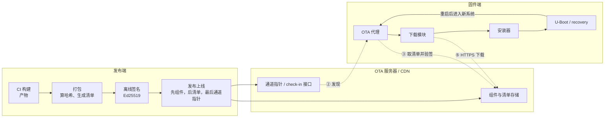
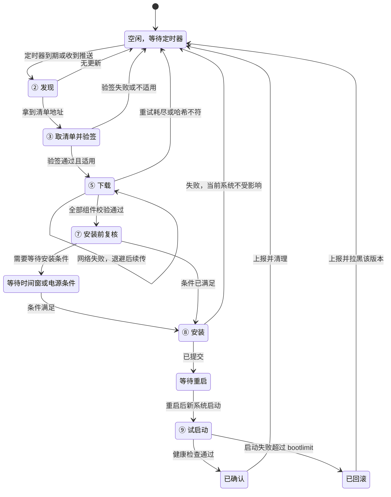
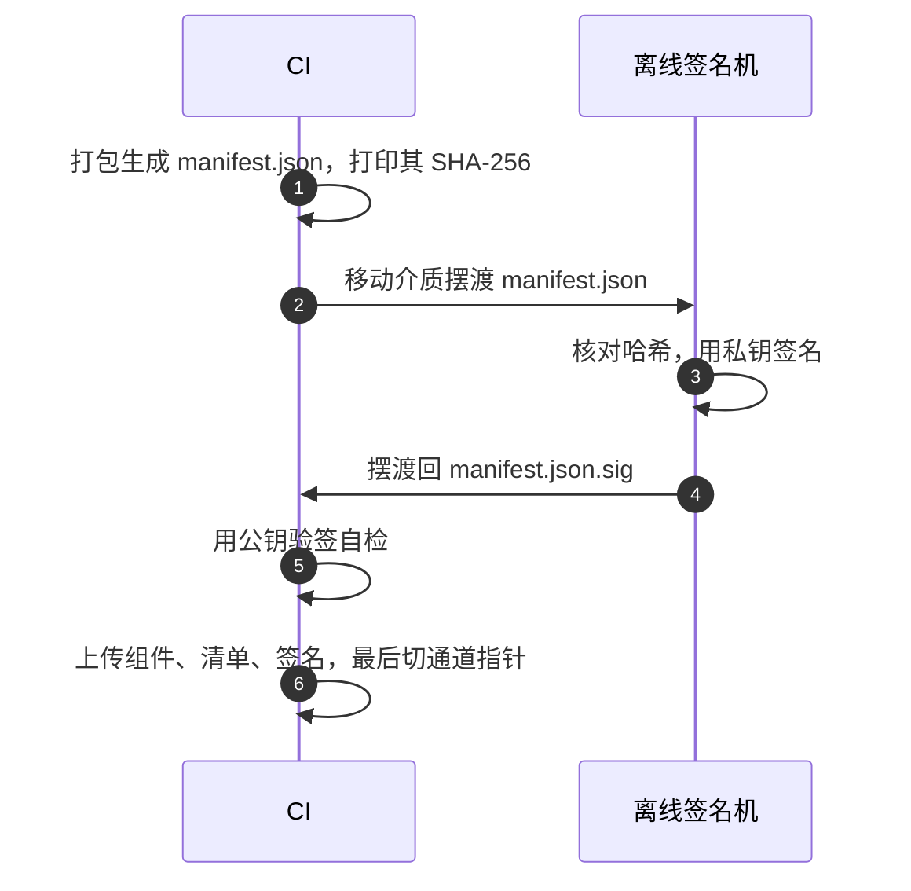
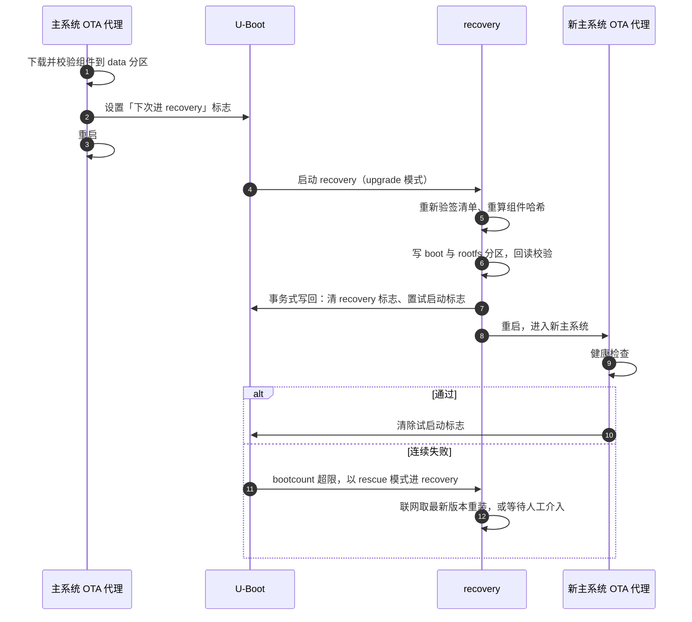

# OTA 标准作业书

> 本文是一套**可移植的 OTA（Over-The-Air）全流程作业书**：从发布端产物，到设备端完成升级、并在失败时自动回滚。适用于嵌入式 Linux 设备，以地平线 X3（ARM64）+ U-Boot + GPT + eMMC/SD 为参考平台；SPI NOR、raw NAND、UBI 等介质的适配边界见 0.2。
>
> 文档只描述**方案、契约、判据和流程**，不绑定具体仓库、文件路径或实现代码。下载环节的参考实现见第 7 章。

## 目录

- 0. 目标、范围与信任模型
- 1. 总体流程
- 2. 发布端
- 3. 下载与订阅方案
- 4. 设备端流程
- 5. 测试与验证
- 6. 落地路线
- 7. 参考实现
- 附录：上游行为依据

---

## 0. 目标、范围与信任模型

### 0.1 目标

- 让设备能安全地拿到「一次构建、一份签名清单、一组组件」，并在校验通过后完成升级。
- 升级失败（坏包、坏固件、掉电、断网）**在 0.2 的平台假设内不导致变砖**，也不需要人工到场；超出这些假设的故障（Bootloader/分区表/环境存储/介质物理损坏）不在本方案的保证范围。
- 发布端一次构建的产物可被多台设备、多个环境（测试/生产/内网镜像）复用。
- 流程对发布端与设备端都是确定的：**同一份清单，两端行为唯一**。

### 0.2 范围边界

首版只升级**内核、设备树、根文件系统**三类组件。以下内容**不在 OTA 范围**，由出厂烧写固定：

| 不升级的内容 | 原因 |
|---|---|
| U-Boot 本体 | bootloader 损坏等于变砖，没有软件可以回滚。需要 SoC 级多镜像回退，或 A/B 两份 bootloader |
| 默认环境镜像 | 同上。运行时代理读写的环境变量是另一回事 |
| 分区表 | 改分区表可能让现有数据全部错位 |
| 启动脚本 `boot.scr` | 它是回滚逻辑的执行者，自身出问题时没有东西能回滚它 |
| recovery 分区本身 | 它是 recovery 方案的最后防线 |

这些内容的升级走单独流程：产线烧写，或日后设计带冗余的 bootloader 升级。

**平台假设**：本作业书的恢复能力以「U-Boot 与 `boot.scr` 可启动、分区表正确、U-Boot 环境存储可读写、启动介质无物理损坏」为前提。任何一条不成立时，A/B 与 recovery 都可能救不回来，只能返厂或产线重刷。

**存储介质基线**：以 ARM64 + U-Boot + GPT + eMMC/SD 块存储为参考实现（见 0.6）。SPI NOR、raw NAND、UBI/UBIFS 的擦除块、坏块管理、卷更新和启动状态存储都要单独适配，不能直接套用本文的整分区写入与 `PARTUUID` 方案。

### 0.3 术语

| 术语 | 含义 |
|---|---|
| **发布清单**（release manifest） | 发布端生成并签名的 JSON，描述一个版本的全部信息：版本号、适用硬件、组件的哈希与地址、安装策略。设备端**只信这份文件** |
| **下载清单**（package manifest） | 下载器读取的简单配置，只描述「下载哪个文件、期望哈希是多少」。它是下载器的输入，不是信任来源 |
| **组件**（component） | 发布清单里的一个可下载文件：内核、dtb、rootfs |
| **暂存区**（staging） | 设备 data 分区上存放已下载、已校验组件的目录 |
| **槽**（slot） | A/B 方案中一套可以独立启动的 boot + rootfs 分区。运行中的叫**活动槽**，另一套叫**非活动槽** |
| **试启动**（trial boot） | 新固件已启动、但未通过健康检查的阶段 |
| **确认**（confirm） | 新固件通过健康检查后，代理清除试启动标志，该槽成为正式槽 |
| **设备端回滚** | 试启动失败时切回可用系统：A/B 是**真回滚**（回到旧槽）；recovery 方案是**重装/重建**（旧系统已被覆盖），两者不混称 |
| **服务端回滚** | 发布端把通道指针指回上一个版本 |
| **回滚攻击** | 攻击者让设备安装一个更旧、但签名有效的版本，由 `security_version` 阻止 |
| **通道**（channel） | `dev` / `beta` / `stable` 等发布通道，设备订阅其中一个 |

### 0.4 信任链

| 环节 | 保护什么 | 不保护什么 | 依赖 |
|---|---|---|---|
| TLS（传输层） | 传输管道：防窃听、防中间人替换流量 | 服务器被攻陷后下发恶意固件；旧版本重放 | 设备时钟正确、CA 证书包 |
| 发布清单签名（Ed25519） | 清单来自持有私钥的发布者，内容未被篡改 | 私钥泄露；旧清单被重放 | 设备内置公钥；私钥离线保管 |
| 组件 SHA-256 | 下载到的字节与清单一致 | 清单本身是否可信 | 清单已验签 |
| 防回滚（`security_version`） | 重放旧版已签名的清单 | 有 root 权限的攻击者改写存储的下限（要用 OTP/eFuse 才能防） | 下限存在 rootfs 之外 |
| 启动确认与设备端回滚 | 新固件启动失败导致变砖 | 新固件「能启动但逻辑错误」 | 健康检查覆盖关键功能 |
| Secure Boot（可选） | 设备不运行未签名的 bootloader 和内核 | — | SoC 支持、熔丝已烧录 |

> **顺序不能反。** 摘要只能证明「字节和清单一致」，清单本身必须先被证明可信：**先验签清单，再用清单里的哈希去下载**。下载模块本身不验签、也不做防回滚，这两项必须在下载前后补上。

**这套信任链的边界**（首版是「签名清单」方案，不是 TUF）：单一签名清单把组件名、大小、哈希绑定在同一份可信元数据里，可防止组件被替换或跨版本拼接；JSON 重复键拒绝用于消除「不同解析器对同一份内容理解不同」的歧义——这两件事机制不同，不能混为一谈。它**不防**服务器完全失陷后长期返回某份签名有效但陈旧的清单（freeze，以及 TUF 意义上的元数据一致性/mix-and-match），也不防拿到本地 root 或物理接触后改写 `boot.scr`/内核/环境（那要靠 Secure Boot/Verified Boot 与 OTP，见 4.12）。要系统性地解决元数据新鲜度与多角色信任，才需要引入 TUF 类框架；首版不引入，作为演进项。

### 0.5 威胁与对策

| 威胁 | 对策 | 所在步骤 |
|---|---|---|
| 传输被降级到明文、重定向到 HTTP | 只允许 HTTPS；证书和主机名校验不可关闭；最低 TLS 1.2 | ⑤ |
| 服务器或 CDN 被攻陷，下发篡改固件 | 发布清单签名 + 组件哈希 | ③ ⑥ |
| 服务器被攻陷，重放旧版清单 | `security_version` 单调递增 | ④ |
| 把别的型号的固件发给设备 | 硬件兼容 ID + 设备型号匹配 | ④ |
| 下载中断，半包被当成正式包 | 临时文件，校验通过才原子改名 | ⑤ ⑥ |
| 下载途中同一地址内容被替换 | 发布端保证地址不可变；最终哈希兜底 | 2.2、2.3、⑥ |
| 安装时掉电 | 只写非活动槽；写完再提交；状态存 U-Boot 冗余环境 | ⑧ |
| 新固件启动失败 | bootcount + 自动切回旧槽 / recovery | ⑨ |
| 设备时钟错误导致 TLS 校验失败 | 下载前检查时间同步 | ① |
| 服务器/CDN 长期返回签名有效的旧清单（freeze） | 设备无法发现更新版本；只能靠通道监控与运维发现；防重放仍由 `security_version` 负责 | 0.4 边界、⑨ |
| 清单与组件跨版本混搭（mix-and-match） | 组件哈希绑定在同一份清单内，且清单先验签；JSON 重复键必须拒绝 | ③ ⑥ |
| 本地 root/物理接触改写启动链 | 清单签名不覆盖启动链；需要 Secure Boot/Verified Boot，并限制 `fw_setenv` 权限 | 4.12 |

### 0.6 平台基线（参考实现）

| 项 | 参考实现（地平线 X3） | 必须确认 / 可适配 |
|---|---|---|
| SoC / 架构 | Horizon X3，ARM64 | — |
| Bootloader | U-Boot（版本与 defconfig 随板卡固定） | 环境存储方式、是否启用 `CONFIG_BOOTCOUNT_LIMIT`、看门狗是否覆盖 U-Boot 阶段 |
| 启动介质 | eMMC 或 SD | SPI NOR / raw NAND / UBI 需要不同的安装后端与回读方式 |
| 分区 | GPT，按 `PARTUUID` 挂载 | MBR、MTD、UBI 卷需重写分区与挂载契约 |
| 启动状态 | U-Boot 冗余环境，放在独立 `bootstate` 分区（4.8） | 是否支持冗余、环境偏移与 `fw_env.config` 必须一致 |
| Bootcount | 自定义 `boot.scr` 计数；原生 Boot Count Limit 可选（4.9） | 后端驱动、`altbootcmd` 是否定义 |
| Recovery | 独立分区，内置 initramfs | 是否具备、版本与信任锚（4.8 方案二） |
| 看门狗 | SoC 硬件看门狗，内核 `nowayout` | 上电即生效还是 Linux 才接管、超时范围 |
| 内核 | 不压缩 `Image` + dtb | FIT/签名启动需单独设计 |
| RootFS | 只读 squashfs，整分区写入 | 其他只读格式需调整回读校验 |
| Data | 可写文件系统，跨版本共享 | 数据格式兼容策略（4.8） |
| Secure Boot | 可选，首版不启用 | 启用后与 OTA 签名的分工（4.12） |

换平台时先补全这张表，再谈流程；表中任何一项与现网不符，对应的章节都必须重新验证。

---

## 1. 总体流程

### 1.1 端到端流程



### 1.2 设备端十步总览

固件端的步骤编号在全文通用：

| 步骤 | 名称 | 一句话说明 |
|---|---|---|
| ① | 前置检查 | 时间、网络、空间、电源都满足才开始 |
| ② | 设备发现 | 得到一个发布清单的地址，或者「没有更新」 |
| ③ | 获取发布清单并验签 | 只有验签通过的清单才被信任 |
| ④ | 适用性判断 | 这份清单是不是给这台设备的、是不是更新的版本 |
| ⑤ | 下载 | HTTPS 下载到暂存区 |
| ⑥ | 固件完整性校验 | SHA-256 与清单一致才发布为正式文件 |
| ⑦ | 安装前复核 | 再核对一遍，确认写的是非活动槽 |
| ⑧ | 安装 | 写入并提交 |
| ⑨ | 启动确认与自动回滚 | 新系统能用才算升级成功 |
| ⑩ | 上报与清理 | 把结果告诉服务端，清掉暂存区 |

### 1.3 设备端状态机



有三处迁移跨越了重启：`PendingReboot → TrialBoot`、`TrialBoot → RolledBack`，以及 `TrialBoot` 期间的断电。进程重启后内存状态丢失，这三处靠 **U-Boot 环境变量 + 设备端持久状态文件** 恢复，见 4.9。`RolledBack` 在方案一表示回到旧槽（真回滚），在方案二表示进入 rescue 重装，两者语义不同（0.3）。

---

## 2. 发布端

### 2.1 产物与版本

**需要的三个文件**（以 Buildroot 为例，构建完成后都在输出目录的 `images/` 下）：

| 组件 | 来源 | 说明 |
|---|---|---|
| 内核 | 内核包产物 `Image` | 保持不压缩，U-Boot 可直接加载 |
| 设备树 | `dtb` | 与内核一起放进 boot 槽 |
| 根文件系统 | `rootfs.squashfs` | squashfs 自带压缩，整分区写入 |

**为什么模块并入 rootfs**：内核和它的模块靠 vermagic 严格配对，必须同时更换；且 Buildroot 在内核开 `CONFIG_MODULES=y` 时会无条件把模块装进 rootfs。合并后，内核、dtb、rootfs 三者永远出自同一次构建。

**版本号怎么定**

| 字段 | 形式 | 例子 | 用途 |
|---|---|---|---|
| `version` | `主.次.修订` | `1.2.3` | 给人看，来自 git tag |
| `version_code` | 单调递增整数（uint64），由 CI 发布库分配 | `10203` | 设备端比较新旧，免解析字符串 |
| `security_version` | 单调递增整数 | `5` | 防回滚 |
| `release_id` | 规范化清单描述的 SHA-256，至少 128 bit | `9f2c1d7a4b6e5c8d0a1f3e7b2c9d4a6f` | 唯一标识一次构建，也是下载地址的一部分 |

四条规则：

- 已发布的 `version`、`version_code` 不能复用。改了任何一行代码，组件哈希变了，`release_id` 就变了，不会和旧包混在一起。
- **`version_code` 不要用语义化版本的算术公式推导**：`主×10000 + 次×100 + 修订` 会让 `1.100.0` 与 `2.0.0` 算出同一个 `20000`，预发布版本也无法区分。由 CI 的发布数据库分配单调递增整数、发布后不复用；`version` 只负责展示。
- CI 打包前检查新版本的 `version_code` 必须大于 stable 通道当前值，防止误发布「降级」版本。
- `release_id` 必须覆盖**所有会影响安装行为的字段**，否则两个组件相同但安装策略不同的发布会撞出同一个 ID，破坏「同一地址内容永远不变」。定义 `release_id = SHA-256(canonical_release_descriptor)`：`canonical_release_descriptor` 是清单去掉 `release_id` 与签名字段后，对所有参与升级决策的字段做规范化编码（对象键排序、数字/字符串统一编码、数组按语义定序）；`schema_version`、`min_version_code`、`data_schema_version`、`min_data_schema_version`、`install.*`、`components[].*` 全都要纳入，不要手工维护一张易漏的字段清单。分辨率至少 128 bit：12 位十六进制只有 48 bit，长期仓库没有必要省这点长度。

### 2.2 打包契约

这是发布端与设备端安装器之间的契约：

| 发布文件名 | 是否压缩 | 设备端写入方式 |
|---|---|---|
| `Image` | 否 | 放进 boot 槽分区，按文件拷贝 |
| `<型号>.dtb` | 否 | 放进 boot 槽分区，按文件拷贝 |
| `rootfs.squashfs` | squashfs 自带压缩 | 整分区写入 |

- 文件名固定，不带版本号；版本只体现在目录名上，设备端安装逻辑不用解析文件名。
- **散件而不是 tar 包**：与「一个清单下载一个文件」一一对应；每个组件可单独续传；内核没变时可跳过；设备端不必为解包再腾一份空间。
- **不再压缩**：squashfs 本身已压缩；内核保持不压缩便于 U-Boot 加载。需要 `Image.gz` 的板子在构建阶段压缩，OTA 流程不变。

**目录布局契约**。打包工具应产出一个只读发布目录，结构固定：

- `releases/<型号>/<版本>/<release_id>/manifest.json`
- `releases/<型号>/<版本>/<release_id>/manifest.json.sig`
- `releases/<型号>/<版本>/<release_id>/files/` 下放各组件

`release_id` 参与路径，保证**同一地址的内容永远不变**（见 2.3 的地址不可变原则）。

### 2.3 发布清单（契约规范）

**顶层字段**

| 字段 | 类型 | 必填 | 含义 |
|---|---|---|---|
| `schema_version` | 整数 | 是 | 清单格式版本。设备不认识的主版本直接拒绝 |
| `release_id` | 字符串 | 是 | 本次构建唯一标识，也是下载地址的一部分 |
| `version` | 字符串 | 是 | 人读版本号 |
| `version_code` | 整数 | 是 | 由 CI 分配的单调递增整数（与 `version` 无算术关系） |
| `security_version` | 整数 | 是 | 防回滚计数，只会增加 |
| `model` | 字符串 | 是 | 目标设备型号 |
| `hardware_compat` | 字符串数组 | 是 | 兼容的硬件 ID 列表，对应设备树 `compatible` |
| `min_version_code` | 整数 | 否 | 安装本包要求的最低当前版本，缺省 0（不限制） |
| `data_schema_version` | 整数 | 否 | 新固件能读、也写入的最高 data 格式，缺省 0（不设上限） |
| `min_data_schema_version` | 整数 | 否 | 新固件能读的最旧 data 格式，缺省 0 |
| `created_at` | 字符串 | 是 | 清单生成时间，UTC |
| `install` | 对象 | 是 | 安装策略 |
| `components` | 对象数组 | 是 | 组件列表 |

**`install` 安装策略**

| 字段 | 类型 | 必填 | 含义 |
|---|---|---|---|
| `mode` | 字符串 | 是 | `download-only` 只下载不安装；`reboot-required` 装好后重启；`immediate` 装好立即重启（无人值守） |
| `window` | 字符串 | 否 | 允许重启的时间窗，如 `"02:00-05:00"`，设备本地时间。检查和下载不受限 |
| `reboot_delay_seconds` | 整数 | 否 | 安装完成后延迟多久重启，给应用保存状态留时间 |
| `layouts` | 字符串数组 | 是 | 本包支持的分区布局：`"ab"`、`"recovery"`，或两者 |

**`components[]` 组件**

| 字段 | 类型 | 含义 |
|---|---|---|
| `name` | 字符串 | 组件名：`kernel`、`dtb`、`rootfs`。安装器按它决定怎么写 |
| `path` | 字符串 | 组件在 OTA 服务器上的路径，**相对服务器根目录** |
| `sha256` | 字符串 | 组件的 SHA-256，小写十六进制，64 位 |
| `size` | 整数 | 组件的字节数 |
| `target` | 字符串 | 写入目标：`boot`（按文件拷贝）或 `rootfs`（整分区写入） |

**设计要点**

- **`path` 用相对路径，不用完整 URL。** 设备端用自己配置的服务器地址拼出完整地址。同一份签名清单可以放在任何域名下（测试/生产/内网镜像），不需要为每个环境重新签名。拼出的地址仍要经 HTTPS 校验。
- **`min_version_code` 与 `security_version` 是两件事。** 前者是「升级路径」（不允许跳过中间版本），后者是「防回滚」（拒绝旧清单）。混成一个字段就无法正确判断。

  | 设备状态 | 判定 | 结果 |
  |---|---|---|
  | 清单 `security_version` < 设备记录的下限 | 回滚攻击，或通道指错 | 拒绝，不下载 |
  | 设备 `version_code` < 清单 `min_version_code` | 升级路径不允许 | 拒绝，上报「需要中间版本」 |
  | 清单 `version_code` ≤ 设备 `version_code` | 已经是这个版本或更新 | 忽略 |
  | 其余 | 正常升级 | 继续 |

- **地址不可变。** 路径里带版本号和 `release_id`，服务器上这个目录一经发布就不再修改。否则同一个地址的内容变了，断点续传会把新旧两段拼成一个坏包（最终哈希能拦住坏包，但整个文件要白下载一遍）。
- **格式兼容。** 新增字段不必提高 `schema_version`，旧设备可忽略不认识的字段；但**安全相关字段**（`security_version`、`sha256`、`size`、`target`、`path`）必须出现在最低支持版本里，缺失即拒绝。只有改变已有字段含义或引入无法安全忽略的字段时，才提高主版本号。

**设备端必须做的严格校验**（验签之后、使用之前）：

| 校验项 | 约束 |
|---|---|
| `schema_version` | 必须是设备支持的版本；主版本不认识直接拒绝 |
| `release_id` | 长度与字符集固定（小写十六进制） |
| `sha256` | 恰好 64 位小写十六进制 |
| `size` | 大于 0，且不超过目标分区与配置上限 |
| `components` | 必需组件（`kernel`/`dtb`/`rootfs`）齐全，`name` 不重复 |
| `target` | 只允许 `boot` / `rootfs` 两个枚举值 |
| `path` | 只能是相对路径：拒绝绝对路径、`..`、带 scheme/host 的 URL、百分号编码绕过；拼出的地址仍以设备配置的服务器为前缀 |
| JSON | 拒绝重复键（不同解析器对重复键取值不一致，会让两端对同一份清单理解不同）、非法类型、超长字段 |

**`name`/`target` 不能变成任意写入路径。** 安装器自己维护「组件名 → 非活动槽分区」的固定映射：`kernel`/`dtb` → 非活动 boot 槽，`rootfs` → 非活动 rootfs 槽，其余名字一律拒绝。清单里的 `target` 只用来确认组件类别，绝不能当块设备路径或目录路径使用。

**`data_schema_version` 与 `min_data_schema_version`**：新固件能读的 data 格式是一个闭区间 `[min_data_schema_version, data_schema_version]`——`min_data_schema_version` 是能读的最旧格式，`data_schema_version` 是能读、也愿意写入的最新格式（不会写一个自己读不了的格式）。设备判据：本机当前 data 格式必须落在这个区间内（`min_data_schema_version ≤ current ≤ data_schema_version`），否则拒绝安装——只检查下界会漏掉「当前数据比固件能读的还新」。字段缺省 0 按宽松语义处理（0 即最小、`data_schema_version` 缺省视为不设上限），发布端应显式填写。当前格式的来源与原子维护见 4.8 的 data 分区。

### 2.4 签名与密钥管理

用**离线保管的私钥**对清单签名，签名覆盖的是清单的**原始字节**（不是解析后的内容），因此清单一旦签名就不能再改，包括改一个空格。

**为什么签清单而不是签镜像**：清单一小（几 KB），验签极快；一份签名保护了包内所有文件；镜像体积大、逐个签名成本高。

**算法选择：Ed25519**。约 128 位安全强度；签名确定性、不依赖随机数（避免 ECDSA 类随机数缺陷导致私钥泄露）；签名仅 64 字节、公钥仅 32 字节，传输和验证都轻。

**操作要点**

1. 在完全离线的机器上生成 Ed25519 密钥对；私钥加口令保护，绝不联网。
2. CI 生成未签名的 `manifest.json`，用移动介质摆渡到离线机。
3. 离线机核对清单哈希后签名，产出独立的 `manifest.json.sig`（64 字节），清单本身原样不动。
4. 摆渡回 CI，CI 用公钥验签自检后才能发布。
5. 把公钥（32 字节原始形式）编译进设备固件，设备端只信任内置公钥。

**密钥去处**

| 密钥 | 去处 | 用途 |
|---|---|---|
| 私钥 | 只留离线机；离线介质两份、异地存放 | 签名 |
| 公钥（PEM） | CI、运维留存 | 上传前自检、人工核对 |
| 公钥（32 字节原始） | 固件源码，编译进设备 | 设备端验签 |

**密钥管理**

- 私钥加口令，口令与备份介质分开保管。Ed25519 签名确定性，同一私钥对同一清单只产生一个签名值；但「`.sig` 出自该私钥」只能由公钥验签判断，确定性本身不是证明。
- **轮换顺序不能反**：设备先持有新公钥，才能接受新私钥的签名。顺序：生成新密钥对 → 发一版带新旧两把公钥、仍用旧私钥签 → 设备都升级后 → 改用新私钥签 → 再发一版删掉旧公钥。
- **私钥泄露时的恢复边界**：单密钥信任模型下，用新私钥签的新清单无法被只信任旧公钥的设备接受；若继续用已泄露的旧私钥给新公钥「背书」，攻击者同样持有旧私钥、也能给自己的公钥背书。所以**没有预置独立恢复密钥 / 多密钥阈值 / 硬件根信任时，泄露无法仅靠普通 OTA 自助修复**——这类设备只能走安全物理通道或产线重新注册。真正可远程自愈的前提，是出厂时预置一把独立的紧急恢复公钥，或采用 M-of-N 阈值与撤销机制。
- 想提高效率可用硬件密钥（YubiKey/HSM），私钥不可导出，属可选演进。

**轮换必须回答的五个问题**（只给顺序不够，这些都要写成契约）：

1. **信任锚存在哪。** 公钥如果只编译进 rootfs，它随 rootfs 一起被替换，也随回滚一起丢。重叠期必须覆盖「升级 + 试启动 + 确认」全过程；在设备确认新版本之前，旧密钥仍要能签出可安装的包。
2. **回滚后怎么办。** B 槽带了新公钥但试启动失败回滚到 A，A 只认旧公钥。此时新私钥签的包在 A 上验不过，必须保留旧私钥签名的恢复包；或者把信任锚放到 rootfs 之外的持久存储（只有在受 Secure Boot/OTP 保护时才有意义）。
3. **旧密钥怎么撤销。** 撤销前要确认目标设备已完成轮换；撤销是发布端与设备端共同的规则，不能只靠「从固件里删掉公钥」。
4. **recovery 的信任锚怎么同步。** recovery 是静态的，不随主系统升级；它的公钥集合要覆盖新旧双钥，或有离线更新机制，否则主系统轮换后 recovery 验不了新清单。
5. **多把公钥的阈值。** 多把公钥并存时，是「任意一把」还是「M-of-N」必须在发布端与设备端写成同一条规则。

> 现实约束：设备规模大、离线时间长时，轮换完成时间可能以月计。轮换按「设备确认率」推进，不能按发布时间推进。

**签名流程**



**设备端验签**：用内置可信公钥（可多把，支持轮换）对清单原始字节做 Ed25519 验签；签名长度必须是 64 字节；验签通过**之后**才解析 JSON。Ed25519 用 PureEdDSA 模式，内部固定用 SHA-512，但**调用者不能像 ECDSA 那样指定外部摘要算法**：OpenSSL EVP 初始化时 `digest` 传 `NULL`，用一次性 `EVP_DigestSign`/`EVP_DigestVerify` 喂入完整消息，不支持普通的流式 `Update`/`Final`。参考实现见第 7 章。

### 2.5 发布上线与回滚

**上传顺序**（顺序错了不会损坏设备，但会白失败一轮）：

1. 上传 `files/` 下全部组件到 `releases/<型号>/<版本>/<release_id>/files/`。单文件写入是否原子取决于具体的对象存储/文件服务器，必须实测；不满足时先传临时名，再由服务端原子改名。
2. 上传 `manifest.json` 和 `manifest.json.sig`。
3. 自检：从外网地址重新下载清单和签名，用公钥验签；抽查一个组件的哈希。
4. **最后**才切换通道指针：静态方案是原子覆盖 `channels/<通道>/<型号>/current.json` 这**一个文件**（内容指向不可变的发布目录）；API 方案是启用一个 deployment。指针切换前，设备看不到这次发布。
5. 观察设备上报结果（失败率、回滚率），再决定是否扩大范围。

> 为什么顺序重要：设备取到清单后会立刻按 `path` 下载。清单先于组件可见，设备会收到 404。

**通道指针必须是单个文件。** 如果通道目录下同时放 `manifest.json` 和 `manifest.json.sig`、靠两次覆盖来切换，切换窗口里会出现「新清单 + 旧签名」的配对，设备验签失败（安全，但会反复失败）。正确做法：通道指针 `channels/<通道>/<型号>/current.json` 只放一个文件，内容形如：

```json
{
  "release_id": "9f2c1d7a4b6e5c8d0a1f3e7b2c9d4a6f",
  "generation": 105,
  "manifest_url": "https://.../releases/<型号>/<版本>/<release_id>/manifest.json",
  "manifest_sha256": "..."
}
```

设备先取指针，再用 `manifest_sha256` 比对取到的清单字节，最后验签。指针本身不参与信任决策（信任来自清单签名），但它的原子性保证「设备看到的一定是完整的一次发布」。若具体服务器的单文件覆盖不原子，就先写临时 key 再原子改名，或改用 API 返回不可变清单地址。`current.json` 未签名、其 `manifest_url` 由服务器提供，因此**初始访问该 URL 也必须走 HTTPS + 主机白名单校验**（与组件下载一致），不能只限制重定向后的主机。

**服务器目录约定**

- `releases/<型号>/<版本>/<release_id>/`：组件、清单、签名，发布后只读、地址不可变。
- `channels/<通道>/<型号>/current.json`：唯一的可变文件，指向某个发布目录。

**CDN / 服务端配置要点**

| 配置项 | 组件与清单（`releases/`） | 通道指针（`channels/`） |
|---|---|---|
| `Cache-Control` | `public, max-age=31536000, immutable` | `no-cache` |
| HTTP Range | 必须支持，返回 `206 Partial Content` | 不要求 |
| 协议 | 全程 HTTPS | 全程 HTTPS |
| `ETag` | 必须（续传用 `If-Range`） | 建议，设备用它做条件请求 |

- 断点续传依赖 Range 与 `ETag`/`If-Range`，细节见 4.5。
- 全程必须 HTTPS：CDN 若把请求重定向到 HTTP 预签名地址，下载会以协议/TLS 错误失败。
- 组件地址不可变，无需刷新 CDN；通道指针被覆盖后要刷新或等过期。

**通道与灰度**：`dev`（开发自测）、`beta`（小批量验证）、`stable`（正式）。静态方案只能按通道推进；API 方案可按设备分组或百分比放开。

**灰度门控**（API 方案必须，静态方案靠人工）：

| 指标 | 用途 | 建议暂停阈值 |
|---|---|---|
| 下载失败率 | 发布/CDN 问题 | 显著高于基线即停 |
| 启动成功率 | 新固件能否起来 | 低于基线（如 98%）即停 |
| 健康确认率 | 业务是否可用 | 低于基线即停 |
| 回滚率 | 试启动失败比例 | 超过预定值即停 |
| 设备离线率 | 升级后失联 | 异常升高即停 |

- 每批要有最小设备样本量与观察时长，样本不足不下结论。
- 统计必须排除网络、硬件损坏、用户断电等非固件因素，否则会误停。
- 触发阈值后自动暂停扩量并告警，恢复扩量必须人工确认。

**服务端回滚**：发现新版本有问题时，把通道指针指回上一版本。这只影响**还没升级**的设备。已升级设备不会「被指回去」（版本号已更高）——要让它们恢复，需发一个版本号更高的包，内容是上一版代码；`security_version` 只能不变或提高。**版本号只增不减**是基本约束。

**历史版本保留**：至少保留最近 5 个版本及任何通道指针引用的版本；长期离线设备需要的中间版本不能删；先切指针、后删文件。

### 2.6 可复现构建（可选）

打开可复现构建选项后，同一源码与配置产出逐字节相同的文件，哈希与 `release_id` 也相同，「这次构建变没变」可直接用哈希回答。它不是正确性前提：无论构建出什么，哈希都对实际产物计算、清单也对它签名。Buildroot 标其为实验性，且要求两次构建使用相同输出目录。

---

## 3. 下载与订阅方案

「订阅」要解决两个问题：设备怎么知道有新固件；设备拿到的是不是给自己的那一份。

无论哪种订阅形态，② 的输出都是同一个：**一个发布清单的地址，或者「没有更新」**。之后 ③–⑩ 完全一致，所以形态可互换，差别只在 ② 这一步。

### 3.1 四种订阅形态

**形态 A：轮询静态清单。** 服务端只有静态文件；设备配置里存服务器地址、型号、通道。设备按周期 `GET` 通道指针 `current.json`，带 `If-None-Match`（ETag）做条件请求，304 即无变化；200 则按指针取清单、用 `manifest_sha256` 比对，再取签名进入 ③。灰度只能按通道推进。局限：服务端不知道设备状态，不能定点升级。

**形态 B：轮询 API（check-in）。** 设备 `POST` 上报自身状态（型号、当前版本、`security_version`、布局、槽），服务端返回「无更新」（204）或「目标清单地址 + 下次轮询间隔」。可做按设备/分组/百分比的灰度，以及上报通道。鉴权可用无鉴权（仅 TLS）、设备令牌或双向 TLS。

公网部署时，形态 B/C 的设备身份至少要满足：每台设备独立凭证、服务端可撤销、设备不能拿别人的凭证取到别的型号/租户的任务、上报带设备认证、令牌不写进公开固件镜像、恢复出厂后有安全的重注册流程。清单签名保护的是「装什么」，设备身份保护的是「谁有权问、问哪一份」，两者不能互相替代。

**形态 C：MQTT 推送。** 广播 topic + 点对点 topic；通知只「叫一声」，不带清单内容、不带固件；设备收到后照常走 ③。用 retained 消息、固定 `client_id`、关闭 clean session，断线重连靠轮询兜底。

**形态 D：轮询 + 推送并存。** 长连接负责快，轮询负责稳；两条路径最终调用同一个入口（给定一个清单地址，开始 ③）。

### 3.2 对比

| 维度 | A 轮询静态清单 | B 轮询 API | C MQTT 推送 | D 轮询 + 推送 |
|---|---|---|---|---|
| 新版本到达延迟 | 一个轮询周期 | 一个轮询周期 | 秒级 | 秒级（连接正常时） |
| 服务端复杂度 | 最低，只有静态文件 | 中：设备注册、鉴权、deployment 管理 | 中到高：Broker、鉴权、topic 授权 | 高，两者都要 |
| 设备端依赖 | 无，复用 HTTPS 栈 | HTTP 客户端，需支持 POST | MQTT 客户端库，长连接 | 两者都有 |
| 设备资源占用 | 低 | 低 | 常驻连接、心跳、重连 | 较高 |
| NAT 与弱网 | 友好 | 友好 | 长连接易被 NAT 断开，需 keepalive/重连 | 轮询兜底 |
| 灰度控制 | 只能按通道，粗 | 细：按设备、分组、百分比 | 点对点可定向 | 细 |
| 可观测性 | 无 | 强：check-in + 上报 | 中：在线状态、上报 | 强 |
| 离线设备与私有化 | 最好：可镜像、可离线导入 | 需部署服务端 | 需部署 Broker | 两者都要 |
| 适用场景 | 小批量、内网、试点 | 中大规模产品 | 时效敏感、需远程干预 | 大规模且要求低时延 |

### 3.3 推荐演进

1. **先做 A。** 服务端零开发，就能把打包、签名、下载、安装、回滚整条链路跑通。
2. **需要看设备状态/灰度时升级到 B。** 设备端只改 ②（多一个 POST），下载、安装、回滚不动。
3. **有低时延要求再加 C**，变成 D。

把 ② 的输出固定成「一个清单地址」，替换订阅方式的代价就被限制在 ② 内部。

### 3.4 轮询策略

| 参数 | 建议值 | 说明 |
|---|---|---|
| 基础间隔 | `stable` 6 小时，`beta` 15 分钟，`dev` 5 分钟 | API 方案由服务端通过 `poll_after_seconds` 下发 |
| 随机抖动 | 间隔的 ±20% | 避免所有设备同一时刻请求 |
| 失败退避 | 1→2→4→…小时，24 小时封顶 | 网络错误、5xx、TLS 失败 |
| 收到推送后的延迟 | 0–60 秒随机 | 避免惊群 |
| 已评估过的清单 | 本地记 `release_id` | 不重复评估，除非是新出现的 |

检查与下载随时可做，不受安装时间窗限制；`install.window` 只约束「重启」这一个动作。

### 3.5 设备侧适用性筛选

按顺序逐项检查，任何一项不通过就停止、不下载：

| 顺序 | 检查 | 不通过时的含义 |
|---|---|---|
| 1 | `model` 与设备型号一致 | 发错对象 |
| 2 | `hardware_compat` 与设备 `compatible` 列表有任意一项相同 | 硬件不兼容 |
| 3 | `install.layouts` 包含本机分区布局 | 安装器不认识这种布局 |
| 4 | 清单 `security_version` ≥ 设备记录下限 | 回滚攻击，或通道指错 |
| 5 | 本机当前 data 格式落在 `[min_data_schema_version, data_schema_version]` 区间内 | 新固件读不了现有数据（太旧或太新），装了也会业务不可用 |
| 6 | 设备 `version_code` ≥ 清单 `min_version_code`（缺省 0） | 需要先升中间版本 |
| 7 | 清单 `version_code` > 设备 `version_code` | 已经是这个版本或更新 |
| 8 | 该 `release_id` 不在本机拉黑列表 | 之前装过并触发了回滚 |

第 2 项数据来自设备树：`compatible` 是 NUL 分隔的字符串列表。第 4 项的下限存在 **U-Boot 环境变量**（而非 rootfs），因为两种方案都会替换 rootfs，而 U-Boot 环境在升级前后一直有效；代理在此只读它做比较，提高时机在 ⑧ 提交、只在新值更大时（见 4.4）。它是软件级防回滚，不是硬件级。第 5 项的当前格式来自 data 分区的 schema 记录。

---

## 4. 设备端流程

### 4.1 ① 前置检查

| 检查项 | 判定方法 | 不通过时 |
|---|---|---|
| 系统时间 | 可信时间源已同步（NTP/受信 RTC），且当前时间不早于固件构建时间 | 等待；超阈值上报 |
| 网络 | 接口已启动、有默认路由、域名可解析 | 按退避重试 |
| 存储空间 | OTA 预留空间足够（按预算算，见下），不是「整个 data 分区可用」 | 清理旧暂存；仍不够则上报放弃，**不删用户数据** |
| 电源 | 有电池的设备：电量高于阈值或正在充电 | 推迟 |
| 当前状态 | 不在试启动中，没有未完成的安装 | 等待 |

> **时间检查为什么第一。** TLS 校验证书有效期依赖系统时钟。没有电池备份 RTC 的设备刚上电可能停在 1970 年，此时 HTTPS 必然校验失败。

> **构建时间不是可信当前时间。** 把时钟拨到构建时间只保证「不会早于这个固件存在的时间」，它是下限，不是事实。若此时就去校验证书：签发时间晚于构建时间的证书会被误拒（`notBefore` 在「未来」），真实世界里已经过期的证书会被误收（设备以为还在构建当天）。正确顺序：① 有可信 RTC 就读 RTC；② 没有就用构建时间/出厂注入时间做启动下限，只用于让系统跑起来；③ 等 NTP 或受信时间源同步；④ 同步成功后才做 TLS 有效期校验；⑤ 同步不了就不发起 OTA，**绝不为了升级而跳过证书校验**。还要把「最后一次可信时间」持久保存（或依赖带电池的 RTC），防止把时钟回拨到证书有效期内。普通未认证 NTP 本身不等于可信时间源：把「NTP 是否认证、RTC 是否可信、最后一次可信时间」分开记录，不要混成一个布尔量。

**空间预算按 OTA 事务算，不是按组件大小算**：`已校验组件 + 下载中的 .part + 清单与签名 + 事务状态 + 上一版恢复副本（方案二必需）+ 文件系统元数据/保留块 + 安全余量`。临时文件与正式文件会同时存在，下载中的包也可能异常膨胀；日志长期增长会侵占预留区。空间不足时只能清 OTA 自己的旧暂存，**不得删除用户数据**。

### 4.2 ② 设备发现

四种订阅形态见第 3 章。输出只有两种：一个发布清单地址，或「没有更新」。

### 4.3 ③ 获取发布清单并验签

**处理顺序**

1. 下载 `manifest.json` 到临时文件；通道指针里带 `manifest_sha256` 时先比对字节哈希（见 2.5）。
2. 下载 `manifest.json.sig`（签名固定 64 字节，多一个都不要）。
3. 用内置公钥表验签，对象是清单的**原始字节**。
4. 验签通过**之后**才解析 JSON：校验字段类型与取值范围，拒绝不认识的主版本。
5. 把清单和签名存进暂存目录（重启或进入 recovery 后还要用）。

**失败处理**

| 现象 | 处理 |
|---|---|
| HTTP 404 | 通道指针指向的清单不存在，发布出错。不重试，下周期再看 |
| 签名不是 64 字节，或验签失败 | **不下载任何组件**；上报告警，记下 `release_id`，本周期不再尝试 |
| JSON 解析失败 | 验签通过但格式不对，发布端工具 bug。同上 |
| JSON 含重复键、字段越界或路径非法 | 畸形清单；解析阶段即拒绝，不下载（规则见 2.3） |
| `schema_version` 不支持 | 设备太旧。同上 |
| 网络、TLS 错误 | 按 3.4 退避重试 |

### 4.4 ④ 适用性判断

规则见 3.5，按序逐项检查。全部通过后只做一件事：**确定后续行为**（`download-only` 在 ⑥ 之后停下等用户确认；`reboot-required` / `immediate` 继续）。

**`security_version` 下限不在这里提高**，而是在 ⑧ 的「提交」里、与启动槽和试启动标志**同一次事务写回**提高（见 4.8 第 5 步）。理由：

- ④ 之后还要经历下载、校验、安装；在这些完成前设备仍运行旧固件。若在下载前就提高下限，一次失败的下载、或 `download-only` 只下载不安装，都会把设备锁到更高的下限，永久失去安装更低安全版本的能力。
- 提交前掉电、安装失败都不应留下「下限已提高但固件没换」的残留。
- 提交时一次性提高仍保留防重放：提交成功即意味着设备接受了这个版本，回滚后旧槽也在新下限上运行，不再接受更旧的清单。

> U-Boot 环境里的 `security_version` 是**软件级防回滚**：有 root 权限的攻击者可以用 `fw_setenv` 改它。要强防回滚，必须把下限放到 OTP/eFuse 或受保护的存储（4.12），并接受其不可逆代价。

> 提高下限与 Recovery 的冲突见 4.8：下限提高后，方案二 R2 离线缓存的上一确认版本若安全版本更低，不能走普通 ④ 安装路径，必须走「恢复上一确认版本」的专用路径（4.8 恢复等级一节）。

### 4.5 ⑤ 安全下载

下载模块负责把组件安全地落到暂存区，保护的是「传输管道」：

- 只允许 HTTPS；拒绝带用户信息的 URL；证书与主机名校验不可关闭，最低 TLS 1.2。
- 重定向逐跳校验：只跟 HTTPS、默认最多 5 次，且只允许跳转到预配置的域名（或域名后缀规则）。CDN 域名要显式列入白名单，跳转到白名单外的主机一律失败；不要把设备令牌带出白名单。
- 禁止透明解压，保证摘要针对原始字节。
- 先写同目录临时文件，`fflush` + `fsync` 后再算摘要；摘要一致才原子改名发布，并去掉可执行位。改名后要 `fsync` 父目录，见下方「持久化顺序」。
- 摘要不一致时删除临时文件，不留下可被误装的包。
- 同一个临时文件只允许一个进程写（文件锁）。
- 断点续传必须带校验条件：`Range: bytes=<已下载长度>-` 配 `If-Range: <首次响应的 ETag>`。续传响应必须同时满足 206、`Content-Range` 起点等于本地长度、远端总大小等于清单 `size`；`ETag` 变了（服务器内容被替换过）就丢弃本地部分整包重下；返回 200 说明服务器忽略了 Range，必须截断旧文件重新写；返回 416 时按本地实际大小与哈希判断是已完成还是越界，不能盲目续传。
- 服务器不支持 Range 或没有 `ETag` 时回退整包下载。不能因为「最终哈希能兜底」就拿两段不可信数据去拼。
- 体积上限、声明大小校验、低速保护（低于阈值持续一段时间即中止）、连接/传输超时。
- 错误分类清晰（参数、IO、网络、TLS、HTTP、协议、体积、校验和不符、Range 不支持），便于代理决定重试还是放弃。

**参考实现**：下载模块的完整实现、参数和退出码见 [firmware_secure_download](https://github.com/guoyulong1/firmware_secure_download)。该模块只负责安全传输与完整性校验，不验证发布者签名、不做防回滚——这两项由 ③ 和 ④ 在调用它之前完成。

**暂存区约定**：暂存目录放在 data 分区（不参与升级），按 `release_id` 分目录，每个版本一个目录。下载中的临时文件按目标路径命名（追加 `.part`），因此同目录只属于一个版本，残留临时文件不可能串到别的版本。

**下载前的本地判断**：目标文件已存在时，下载器默认拒绝覆盖。代理应先用哈希判断：已存在且哈希等于清单值 → 跳过（上次已下完，可能安装前断了电）；存在但哈希不符 → 删除重下；不存在 → 下载。

**持久化顺序**：`write → fsync(file) → 校验 → rename → fsync(parent dir)`。文件 `fsync` 只保证内容落盘，不保证目录项；`rename` 之后再 `fsync` 父目录，才保证「改名」这件事在掉电后仍然成立。全局 `sync` 是补充，不能替代这两步。

**重试策略**：只对网络类错误重试。

| 第几次重试 | 等待 |
|---|---|
| 1 | 1 分钟 |
| 2 | 5 分钟 |
| 3 | 15 分钟 |
| 4–8 | 30 分钟 |
| 用尽 | 放弃，等下个发现周期；连续 3 个周期用尽后上报 `failed` |

**错误码 → 代理动作**（关键几种）：参数/清单不合法 → 不重试、上报；IO → 查空间/挂载，清理后重试一次；网络 → 退避续传；TLS → 不重试、告警（查时钟与 CA）；HTTP 4xx → 不重试、重新走 ②；5xx → 退避；协议/体积 → 不重试、告警；校验和不符 → 临时文件已删，最多重试 2 次防 CDN 坏块，连续不符则告警放弃；Range 不支持 → 内部已回退整包，通常看不到。

全部组件下载完成后执行一次 `sync`（下载器改名后对目录项是否落盘只告警不报错，`sync` 补上这个窗口）。

### 4.6 ⑥ 固件完整性校验

下载器在 `fflush` + `fsync` 之后对临时文件整个文件计算 SHA-256，与清单的 `sha256` 比较，一致才改名为正式文件（改名后 `fsync` 父目录，见 4.5）。所以 ⑤ 结束即 ⑥ 完成。

这一步证明：暂存区里的文件与已验签清单记录的哈希完全一致。加上 ③ 的验签，信任链闭合：私钥持有者签了清单 → 清单记录哈希 → 下载字节匹配哈希。

**只用 SHA-256，不用 MD5**：MD5 碰撞早已实用化，签名的清单里也只放 SHA-256；下载器接受 MD5 仅为兼容，OTA 代理应把 MD5 留空。

**四层校验，对象不同，不能互相替代**：

| 校验 | 证明什么 |
|---|---|
| 下载后 SHA-256 | 暂存区文件字节正确 |
| 安装前重算 SHA-256 | 待写入文件在下载与安装之间没有损坏或被替换 |
| 写入后回读 | 存储介质上实际写进去的内容与镜像一致 |
| 启动后健康检查 | 镜像真的能启动并完成业务（⑨） |

eMMC/SD 可以按镜像长度做整段回读；NAND/UBI 要用与介质匹配的读回与卷校验方式（见 0.6）。

### 4.7 ⑦ 安装前复核

1. **重算暂存文件哈希**：下载与安装之间若发生重启，文件可能因断电损坏；再读一遍代价很小。
2. **确认写入目标**：A/B 方案里写入目标必须是非活动槽。这是安装器最重要的一条断言：**正在运行的槽，升级全程一个字节都不能动**。组件名必须命中固定映射（`kernel`/`dtb` → 非活动 boot 槽，`rootfs` → 非活动 rootfs 槽），其余名字拒绝；`target` 只用于核对类别，绝不参与路径拼接。
3. **确认组合兼容**：内核、dtb、rootfs 必须同源（同一 release 构建），`vermagic` 与模块一致，dtb `compatible` 覆盖本机，`install.layouts` 匹配；`min_data_schema_version` ≤ 本机当前 data 格式（见 4.8 的 data 分区）。
4. **确认容量**：目标分区容量大于组件 `size`，且安装后回读有足够空间。
5. **确认安装条件**：`install.mode`、`install.window`、电源条件。
6. **通知应用**：进入「即将升级」状态，停止写入关键数据、保存状态、点灯或界面提示。

### 4.8 ⑧ 安装

两套方案的 ①–⑦ 完全相同，差别从这里开始。设备出厂时已确定分区布局，代理只接受 `install.layouts` 包含这种布局的清单（3.5 第 3 项）。`install.layouts` 是布局**枚举**（`ab`/`recovery`），不是版本号或尺寸描述：改分区尺寸/编号要新增枚举值，不能复用旧值的含义。

#### 方案一：A/B 双分区

**分区表**（GPT，分区 UUID 建表时固定；启动参数用 `PARTUUID` 指定根分区，不用设备名，避免 eMMC/SD 编号互换）。**产线要保证磁盘 GUID 与各分区 PARTUUID 按设备唯一、或已验证**：直接克隆同一份磁盘镜像会让多台设备拥有相同 PARTUUID，eMMC 与 SD 混插时可能指错根分区。

| 分区 | 名称 | 内容 | 容量示例 | 随 OTA 变化 |
|---|---|---|---|---|
| 1 | `uboot` | U-Boot、`boot.scr` | 64 MiB | 否 |
| 2 | `bootstate` | U-Boot 冗余环境（两份） | 16 MiB | 否 |
| 3 | `boot_a` | 内核、dtb | 64 MiB | 是 |
| 4 | `boot_b` | 内核、dtb | 64 MiB | 是 |
| 5 | `rootfs_a` | rootfs 整镜像 | 512 MiB | 是 |
| 6 | `rootfs_b` | rootfs 整镜像 | 512 MiB | 是 |
| 7 | `data` | 用户数据、OTA 暂存 | 剩余空间 | 否 |

rootfs 是只读 squashfs，运行期不会因掉电损坏；可写数据全放 data 分区。

**启动状态单独成区**：U-Boot 本体和 `boot.scr` 日后重刷时，不应该连环境一起覆盖。`bootstate` 的物理地址要两侧对齐，两套视角必须映射到同一组物理扇区：

- U-Boot：`CONFIG_SYS_MMC_ENV_DEV`（MMC 设备）、`CONFIG_SYS_MMC_ENV_PART`（eMMC 硬件分区，**不是 GPT 分区号**）、`CONFIG_ENV_OFFSET`（相对所选存储区域的偏移）、`CONFIG_ENV_OFFSET_REDUND`、`CONFIG_ENV_SIZE`。
- Linux：`/etc/fw_env.config` 直接指向分区设备，两行分别是分区内的两个偏移：`/dev/mmcblk0pN <offset_1> <env_size>` 与 `/dev/mmcblk0pN <offset_2> <env_size>`。

不能想当然地认为「U-Boot 用 `/dev/mmcblk0p2`、Linux 也写 `/dev/mmcblk0p2` 就同一块」——U-Boot 用的是相对 eMMC 用户区起点的偏移，Linux 用的是分区内偏移。这些值必须在产线配置里固定并记录。

**安装步骤**（设运行在 A 槽，目标 B 槽）：

1. **开事务**：生成 `transaction_id`，写状态文件（字段见下）并 `fsync`，记录 `source_slot`、`target_slot`、`previous_confirmed_slot`。
2. 写 rootfs 分区：整分区写入，然后**回读校验**（只读镜像长度那么多字节，分区多出的部分不比较）。
3. 写 boot 槽分区：格式化后按文件拷贝内核与 dtb，校验哈希，`sync` 并卸载。
4. `sync`，确保 data 分区文件落盘；状态文件推进到 `pending_reboot`。
5. **提交**：一次事务写回四个 U-Boot 环境变量（`bootslot=<目标槽>`、`upgrade_available=1`、`bootcount=0`、`security_version=<清单值>`，只在更大时提高）；写完回读校验。
6. 重启：按 `install.mode` 执行；`immediate` 加延迟，`reboot-required` 还要等时间窗。

**状态文件字段**（data 分区；同样用临时文件 + `fsync` + rename + 目录 `fsync`）：

| 字段 | 含义 |
|---|---|
| `transaction_id` | 本次安装尝试的唯一 ID（UUID）；同一 `release_id` 重试也是新事务 |
| `release_id` | 目标版本 |
| `source_slot` / `target_slot` | 从哪个槽发起、写入哪个槽 |
| `previous_confirmed_slot` | 安装开始时的确认槽 |
| `previous_confirmed_release_id` / `previous_confirmed_manifest_sha256` | 上一确认版本的标识与清单哈希，R2 专用恢复路径校验用 |
| `install_stage` | `installing` / `written` / `pending_reboot` / `trial` / `confirmed` / `rolled_back` / `failed` |
| `boot_attempt` | 试启动第几次，用于与服务端对账 |
| `started_at` / `updated_at` | UTC 时间 |

状态文件不是启动决策的权威（权威是 U-Boot 环境），它记录的是「这次事务做到哪一步」，用于恢复和上报。

**三个持久化对象的权威关系**：

| 对象 | 负责 | 权威性 |
|---|---|---|
| U-Boot 环境（`bootstate`） | 启动槽、试启动标志、确认槽、计数、安全下限 | 启动决策的唯一权威 |
| OTA 事务文件（data） | `transaction_id`、目标槽、阶段、错误信息 | 升级恢复的依据 |
| 当前运行系统（`ota.slot`/PARTUUID、版本） | 实际运行槽、软件版本、健康状态 | 运行事实 |

冲突时：启动以环境为准，恢复以事务文件为准，运行事实以 `ota.slot` + PARTUUID 为准；三者不一致就按下表处理，不允许用推测值去写槽。

| 异常状态 | 处理 |
|---|---|
| 环境有效、事务文件损坏/丢失 | 以环境为启动决策，不自动确认；按 4.9 回滚识别表恢复 |
| 事务记目标 B、实际启动 A、环境已回滚（`bootcount>bootlimit`） | 按回滚流程补做清理与上报 |
| `ota.slot` 与 PARTUUID 不匹配 | 不确认、不写任何槽，上报异常 |
| 环境单份 CRC 坏 | 冗余环境自动选另一份，继续启动 |
| 两份冗余环境都无效 | 不执行更新、不做推测性写入，进安全恢复/产线 |
| `upgrade_available=1` 且事务文件损坏 | 不做健康确认，按脚本回退到 `confirmed_slot`，不上报 `confirmed` |

**安装是分阶段事务，必须幂等**：每个阶段先落盘状态再进入下一阶段；掉电后从最后一个已落盘阶段继续，或安全重做当前阶段（重做只写非活动槽，不碰运行槽）。禁止：重复提交已回滚的版本、安装中途重启到未完成的目标槽、在确认前删掉唯一可恢复的旧版本副本（方案二的恢复缓存）。

**要点**

- **提交点只有一个**（第 5 步）。之前掉电，环境变量没变，设备照常从旧槽启动；之后掉电，从新槽启动、进入试启动。两种结果都能从环境变量识别，因为环境变量是唯一真值来源。
- **整组变量必须事务式落盘**：`fw_setenv -s` 只是「逐行改内存、最后统一 flush 一次」，它**不保证任一行失败时全有或全无**——上游 `fw_parse_script()` 在中间某行失败时仍会 `fw_env_flush()`，把已成功的行写进去。所以提交/确认/回滚必须：① 写前预校验全部键值、类型与容量；② 全部应用到内存副本、任一行失败即中止且**不 flush**；③ 全部成功才 flush 一次。实现可用 libubootenv 的 API 自建这个事务，或把整组相关启动状态序列化进单个环境变量。分三次 `fw_setenv` 更糟：中间掉电会留下「`bootslot` 已换、`upgrade_available` 还是 0」的中间态，等于把未确认固件当正式槽。前提是冗余环境（4.12），写完回读校验。
- **状态文件只是辅助**：它先于提交点写入；若在写它和提交之间掉电，重启后代理看到「状态说待重启，但 `bootslot` 仍是确认槽、`bootcount` 也没有回滚标记」，就重做一次提交（幂等）。注意不能只看「环境变量没变」：回滚之后的值和从未提交时一样，必须靠 `bootcount` 留下的回滚标记区分，见 4.9。
- **安装失败不影响当前系统**：写入/校验失败时清理非活动槽状态、上报失败，设备继续用旧槽运行。

**变体**：boot 槽用 FAT 则把格式化换成 `mkfs.vfat`；把 boot 槽做成整镜像则内核与 dtb 合并为一个组件，按整分区写入 + 回读校验（代价是内核没变时不能单独跳过）。

#### 方案二：单系统 + recovery

**分区表**

| 分区 | 名称 | 内容 | 容量示例 | 随 OTA 变化 |
|---|---|---|---|---|
| 1 | `uboot` | U-Boot、`boot.scr` | 64 MiB | 否 |
| 2 | `bootstate` | U-Boot 冗余环境（两份） | 16 MiB | 否 |
| 3 | `boot` | 主系统内核、dtb | 64 MiB | 是 |
| 4 | `recovery` | recovery 内核（内置 initramfs）、dtb | 64 MiB | 否 |
| 5 | `rootfs` | rootfs 整镜像 | 512 MiB | 是 |
| 6 | `data` | 用户数据、OTA 暂存 | 剩余空间 | 否 |

**recovery 镜像构成**：用第二个根文件系统配置构建（输出目录与主系统分开），产物是内置 initramfs 的内核；只放几样东西——busybox、`fw_setenv` 工具、boot 分区的文件系统工具、与主系统同一套静态链接的 OTA 校验/安装程序；入口是 `/init`。

**升级流程**



**A. 主系统内**：①–⑥ 同方案一；`sync`；写状态文件（待 recovery，带 `release_id`）；提交（`ota_recovery=1`、`recovery_mode=upgrade`，事务式写回）；重启。

**B. U-Boot**：看到 recovery 标志，启动 recovery 分区内核。

**C. recovery**：挂载 `/proc`/`/sys`/`/dev`，等 mmc 设备；读写挂载 data；读状态文件找暂存目录；**重新验签清单、重算每个组件哈希、重做 ④ 全部检查**（recovery 以最高权限写系统分区，不能假设主系统已检查过）；写 boot 分区（格式化、拷贝、比对、`sync`、卸载）；写 rootfs 分区并回读校验；成功则**事务式写回**（`ota_recovery=0`、`upgrade_available=1`、`bootcount=0`、`recovery_count=0`）、写结果、重启；失败则不动 `ota_recovery`、重启，由 U-Boot 下次进 recovery 时累加 `recovery_count`。

**`recovery_count` 在 U-Boot 侧累加，不在 recovery 程序里累加**：`boot.scr` 每次准备进 recovery 前 `recovery_count++` 并 `saveenv`，再加载 recovery。这样 recovery 自身初始化失败、甚至挂死（靠看门狗复位）也会被计入；recovery 只在「主系统写完、试启动标志置好」那次事务写回里把它清零。正常进入 rescue 等待人工时，不再把等待时间累加成失败。

**D. 新主系统**：试启动标志为 1，健康检查、确认、上报同方案一（4.9）。

**rescue 模式**：recovery 有两种模式——`upgrade`（代理触发，装暂存区里的版本）与 `rescue`（`recovery_count` 达到 `recovery_limit`、或新系统连续启动失败超限，停在 recovery，联网取最新版本重装，或等待人工介入，用指示灯提示）。rescue 需联网下载，所以 recovery 里的 OTA 程序需同时具备下载、验签、安装三种能力（静态链接即可）。

> 主系统已不完整且设备无网络时，唯一办法是保留一份「上一个确认过的版本」的暂存副本，让 rescue 离线恢复；代价是 data 分区多占一套组件。

**恢复等级**：方案二能提供什么，取决于 data 里留了什么，必须明确定级，不能笼统说「能回滚」。

| 等级 | 能力 | 结果 |
|---|---|---|
| R0 | 只能进 recovery shell | 需人工维修 |
| R1 | 能重装当前（或通道）版本 | 恢复到可启动，但旧版本已丢 |
| R2 | data 里保留上一确认版本的完整组件 | 可离线装回旧版本，停机可接受 |
| R3 | rescue 可联网、可选版本、可被运维控制 | 远程救援 |

首版建议至少 R2：A/B 天然保留旧槽；方案二只有 R2 才配得上「无需人工到场」。代价是 data 多占一套组件，空间预算要算进去（4.1）。

**R2 与 `security_version` 的冲突必须闭环**：提交时下限已提高，R2 缓存的上一确认版本往往低于当前下限。若 R2 走普通 ④ 安装路径，会被 `security_version` 拒绝，离线恢复就废了。规定 R2 走**「恢复上一确认版本」的专用路径**，而不是普通安装：

- 升级前，代理把 `previous_confirmed_release_id`、`previous_confirmed_manifest_sha256`（或整份 manifest+sig）、`previous_confirmed_security_version`、各组件哈希一起写进持久状态；R2 缓存保存对应的完整 manifest+sig+组件。
- R2 恢复时，recovery 校验缓存 manifest 的签名与组件哈希，**必须与事先记录的那一份逐字节一致**，然后直接安装。允许安装的只限于「本机事先确认过的那一个精确版本」，不允许借这条路径指定任意更低版本。
- 恢复**不下调** `security_version` 下限，也不调用普通 ④；记一次恢复事件并上报。
- 若缓存缺失或不匹配，走备选方案：发布端把旧版本内容重新打包成更高 `version_code`、更高 `security_version` 的「修复包」，设备按正常规则安装。

**recovery 自身也会过期**：它不参与 OTA，却要一直理解新系统。recovery 必须声明并能校验：支持的清单 `schema_version` 范围、公钥集合（至少覆盖轮换期双钥）、分区布局版本、最低可恢复的主系统版本。主系统升级改变这些契约时，要同步评估 recovery 是否还救得回来；recovery 的离线升级另立流程（0.2）。

#### 两套方案对比

| 维度 | A/B 双分区 | 单系统 + recovery |
|---|---|---|
| Flash 占用 | 高：boot 和 rootfs 各两份 + 暂存 | 低：一份主系统 + 小 recovery + 暂存 |
| 升级期间可用性 | 不中断，只在切换时重启一次 | 中断，写主系统期间设备不可用几分钟 |
| 新固件启动失败后 | 自动切回旧槽，几分钟恢复 | 只能进 recovery 重装，旧系统已被覆盖 |
| 回滚含义 | 真回滚（回到旧固件） | 重装（同版本再装或装另一版本） |
| 掉电安全 | 好，活动槽全程不动 | 写主系统时掉电，主系统不完整，必须靠 recovery |
| 暂存区 | 必须有一份 | 必须有一份，且是恢复时唯一数据来源 |
| 适用场景 | 7×24 运行、无人值守、要求自愈 | Flash 小、可接受升级停机、成本敏感 |

Flash 预算示例（rootfs 300 MiB、boot 64 MiB）：A/B ≈ 300×2 + 64×2 + 300 ≈ 1.0 GB；recovery ≈ 300 + 64 + 64 + 300 ≈ 730 MiB。

#### data 分区与数据兼容

两套方案共用 data 分区。回滚必须连数据一起回滚——**rootfs 回滚成功但 data 已被新版本不可逆改写，等于没恢复**。典型故障：B 首次启动把数据库 schema 从 1 升到 2，B 随后被回滚到 A，A 只会读 schema 1，设备能启动但业务不可用。

**契约**：

- **N 与 N-1 兼容 + 可读区间**：新固件能读的 data 格式是 `[min_data_schema_version, data_schema_version]` 的闭区间；本机当前格式必须落在区间内（`min ≤ current ≤ max`），否则在 ④/⑦ 拒绝安装——只检查下界会漏掉「当前数据比固件能读的还新」。
- **schema 记录本身要可靠**：当前 data 格式记录放在 data 分区（不随 rootfs 换），原子维护（临时文件 + `fsync` + rename + 目录 `fsync`）；首次运行写入；记录损坏或缺失时按「未知」处理，只走保守路径（拒绝要求迁移的安装、回退到确认槽或 recovery）。
- **试启动期间不做不可逆迁移**：迁移只在确认之后执行。试启动阶段只允许「兼容读取 + 写新格式副本」。
- **迁移可回滚**：双版本目录（如 `data/v1/`、`data/v2/`）、版本化数据库或迁移前备份；旧格式保留到新版本确认之后。
- **确认后的迁移失败也要兜底**：此时 `upgrade_available=0`，Bootloader 不会再自动切回旧槽。必须「先建新副本 → 校验 → 原子切换到新 schema → 保留旧副本」，任一步失败就回退到旧副本并告警；不能出现「已上报 confirmed、迁移失败、主应用起不来」。
- **迁移幂等、可续做**：迁移过程自己写状态文件，掉电后从最后一个完整步骤继续；迁移失败不得破坏旧数据。
- **空间**：备份副本计入 4.1 的空间预算。

> 这一条不满足时，A/B 的「回滚」只在系统层成立，业务层仍然不可用。测试见 5.2 的 T23、T24、T34。

### 4.9 ⑨ 启动确认与自动回滚

**闭环**：安装成功不等于升级成功。新固件要能启动、业务健康、**确认状态已持久化**，三件事都完成才算升级成功；任何一步失败都要在有限次启动内退回可用系统。

**U-Boot 环境变量**

| 变量 | 含义 | 谁写 |
|---|---|---|
| `bootslot`（方案一） | **本次准备启动的槽**，不代表已确认 | 代理安装提交时；`boot.scr` 回滚时 |
| `confirmed_slot`（方案一） | 最近一次通过健康检查、可回退的槽 | 出厂（`a`）；代理确认时 |
| `ota_recovery`（方案二） | 1 表示下次进 recovery | 代理发起升级；recovery 失败重试；`boot.scr` 超限；recovery 成功后清 0 |
| `recovery_mode`（方案二） | `upgrade` 或 `rescue` | 代理（发起升级置 `upgrade`）；`boot.scr`（超限置 `rescue`） |
| `recovery_count`（方案二） | recovery 进入次数（失败计数） | `boot.scr` 进 recovery 前 +1；recovery 成功后清 0 |
| `recovery_limit`（方案二） | recovery 最大重试次数 | 出厂写入（如 3），OTA 不改 |
| `upgrade_available` | 1 表示当前固件尚未确认，处于试启动 | 代理；recovery；`boot.scr` |
| `bootcount` | 试启动期间连续启动次数 | `boot.scr`（回滚时保留超限值作标记） |
| `bootlimit` | 允许的最大启动尝试次数 | 出厂写入（如 3），OTA 不改 |

`bootslot` 与 `confirmed_slot` 必须分开：前者是「这次从哪启动」，后者是「回滚到哪」。回滚一律回退到 `confirmed_slot`，而不是「另一个槽」——写坏的槽也可能正好是「另一个槽」。0/1 标志只用 0/1 赋值，不删变量。

代理判断「当前跑在哪个槽」不能读 `bootslot`——那是启动意图，不是事实。首版只用一种传递方式：`boot.scr` 把实际启动槽加进 `bootargs`（`ota.slot=<a|b>`），代理读 `/proc/cmdline` 得到它，并与根分区的 `PARTUUID` 交叉验证。两者不一致或缺失，说明本次没按意图启动（例如环境写入失败、人工在 U-Boot 里改过槽），按 4.8 的异常处理表处理，绝不确认。设备树 `/chosen` 是以后的可选项，不要在首版混用两套读取路径。（RAUC 用 `rauc.slot=` 做同一件事。）

**`boot.scr` 的判定顺序**

方案一（A/B）：

1. **补默认值并校验**：`confirmed_slot` 缺失/非法 → 取出厂默认 `a`；`bootslot` 缺失/非法 → 取 `confirmed_slot`；`upgrade_available`、`bootcount` 缺失 → 0；`bootcount` 不是数字 → 按 `bootlimit + 1` 处理（宁可回滚，不无限重试）。
2. `upgrade_available=1` 时 `bootcount++` 并 `saveenv`。**先落盘再启动**，本次启动中掉电计数也不丢。`saveenv` 失败不能当已计数：本次只启动 `confirmed_slot`、绝不确认新固件，保留事务与环境原状，把环境存储故障作为严重错误记录。若环境一直不可写，计数无法继续累积到 `bootlimit`，也就**不承诺**还能靠计数完成持久化回滚——此时设备停在 `confirmed_slot` 上受限运行，等环境恢复后重新协调状态，或转人工/产线恢复。
3. `bootcount > bootlimit` 时回滚：`bootslot=confirmed_slot`、`upgrade_available=0`，事务式写回并保存，**但不清 `bootcount`**（超限值留着当回滚标记，见下）。
4. 按 `bootslot` 加载内核与 dtb；加载失败则 `reset`——本次已计数，下次继续消耗尝试次数。

方案二（单系统 + recovery）：

1. 同上的默认值与校验。
2. **`ota_recovery=1` 最优先**：按 `recovery_mode` 进 recovery。这里**不清 `ota_recovery`**——recovery 可能正写到一半，清掉它下次就会去启动不完整的主系统；标志由 recovery 在「主系统写完、试启动标志置好」之后自己清。
3. `upgrade_available=1` 时 `bootcount++` 并保存；超过 `bootlimit` 则置 `ota_recovery=1`、`recovery_mode=rescue`、`upgrade_available=0`，保留超限计数，事务式写回后复位进 recovery。
4. 否则启动主系统；加载失败则 `reset`。

> 两套方案不混用，`bootslot` 和 `ota_recovery` 不会同时有效。若某台设备真要两者兼有，必须先把这张顺序表写死并逐项测试——靠「看起来不冲突」是不够的。方案二里，人工/持久请求的 rescue 必须高于试启动超限，否则新固件连续失败时，超限回滚会把现场唯一的救援入口盖掉。

**计数语义**

`bootlimit=3` 时：

| 启动序号 | `bootcount` | 动作 |
|---|---|---|
| 第 1 次 | 1 | 尝试启动新固件 |
| 第 2 次 | 2 | 再试 |
| 第 3 次 | 3 | 再试 |
| 第 4 次 | 4 | `4 > 3`，回滚到 `confirmed_slot` |

计数发生在**启动脚本执行时**，不是内核起来之后，所以 `bootlimit` 是「启动**尝试**机会」，不是「完整启动机会」：第 1 次如果在「计数已保存、内核还没起来」时掉电，这次也算用掉了。掉电和起不来在脚本里无法区分，只能保守计数。

> 为什么在启动脚本里计数、而不用 U-Boot 自带的 Boot Count Limit：原生机制并不是「每次启动都计数」——`bootcount_env` 驱动里 `bootcount_load()` 和 `bootcount_store()` 都以 `upgrade_available` 非零为前提，`upgrade_available=0` 时不加载、不 `env_save`，正常运行既不擦写环境也不会累积到上限；`bootcount > bootlimit` 时才改用 `altbootcmd`。门控原生机制本来就有，用它当放弃理由是错的。
>
> 两者都能做到「只在试启动期间计数」，选哪个取决于启动流程有多复杂。本文选脚本：优先级（recovery、选槽、回退到 `confirmed_slot`、回滚标记）已经全在 `boot.scr` 里，计数放进去只有一处真值；原生机制则要求 `CONFIG_BOOTCOUNT_LIMIT`、可用的 bootcount 驱动，而且 `bootlimit` 生效时 `altbootcmd` 必须定义——只给 `bootlimit` 不给 `altbootcmd`，U-Boot 会停在交互提示符，对无人值守设备是新的砖化路径。原生机制完整、`altbootcmd` 也写好了的板子，用它更省代码。
>
> **二选一，绝不同时用**：原生机制在运行 `bootcmd` 之前就加一并保存，脚本再加一就是同一个计数加两次；`bootlimit` 生效时超限会直接改跑 `altbootcmd`，脚本里的回滚逻辑根本不会执行。
>
> 如果改用原生 Boot Count Limit：`bootcmd` 只做选槽，`altbootcmd` 负责回滚（`bootslot=confirmed_slot`、`upgrade_available=0`、保留 `bootcount`），并在产线检查里确认 `bootlimit` 生效时 `altbootcmd` 一定存在、不会落到交互提示符。后端要区分：`CONFIG_BOOTCOUNT_ENV` 用 U-Boot 环境变量，Linux 侧用 `fw_setenv`/`fw_printenv` 对齐同一份环境；`CONFIG_BOOTCOUNT_FS` 是文件系统里一份含 magic/version/bootcount/upgrade_available 的记录文件，**不等于** `fw_printenv` 读到的环境变量，Linux 侧清标志要按该文件格式另定义写入方式。

**环境变量怎么扛掉电**

整个状态机以 U-Boot 环境为唯一真值，所以环境写入必须扛得住掉电：

- **冗余环境**（`CONFIG_ENV_REDUNDANT`）：写另一份，再把当前份标记失效；写一半掉电，至少一份完整。
- **整组变量事务式落盘**：提交、确认、回滚都要求「预校验 → 全部应用到内存副本 → 任一行失败即中止不 flush → 全部成功才 flush 一次」。`fw_setenv -s` 只是逐行改内存、最后 flush 一次，**不保证中途失败时全有或全无**（上游 `fw_parse_script()` 中间失败仍会 flush），用它必须配合预校验，或用 libubootenv 自建事务。分三次 `fw_setenv` 更糟——中间掉电会留下「`bootslot` 已换、`upgrade_available` 还是 0」的中间态，等于把没确认的固件当成正式槽。
- **检查返回值并回读**：返回 0 只说明它认为写成功；再 `fw_printenv` 读一遍，值对才算落盘。确认时尤其如此。`fw_setenv`/`fw_printenv` 之间有 `flock` 串行化，代理与 recovery 不会互相踩写。

**启动失败必须表现为一次重启**：计数只在脚本执行时加一，所以回滚能触发的前提是——新固件的每一种失败最终都变成一次重启。

| 失败形态 | 默认行为 | 需要的配置 |
|---|---|---|
| 内核 panic | 停住不动 | 启动参数加 `panic=10`，10 秒后自动重启 |
| 内核启动后挂死/init 失败 | 停住不动 | 硬件看门狗 |
| 系统起来了但应用起不来 | 一直运行 | 健康检查门控的看门狗，或确认期限 |
| 内核镜像损坏，加载失败 | 回到启动脚本 | 脚本末尾的复位 |
| U-Boot 自身挂死 | 无解 | 硬件看门狗（U-Boot 不在 OTA 范围） |

**看门狗的生命周期**（只靠 Linux 里一个进程开 `/dev/watchdog` 不够）：

| 阶段 | 谁负责 |
|---|---|
| 上电 → U-Boot | SoC/PMIC/外部监督器；U-Boot 阶段也要有硬件超时兜底 |
| U-Boot | 按硬件要求保持或交接 WDT；不能假设 Linux 能救 U-Boot 挂死 |
| Kernel | 尽早 probe 并打开 WDT，`nowayout=1`，避免「关掉 fd 就停」 |
| init | 启动独立的 watchdog 管理进程 |
| 试启动 | 只在「启动阶段推进」时喂狗，健康检查通过前不无条件喂 |
| 正常运行 | 持续监控业务健康，确认之后也不停 |

**早开、晚喂**：用户态一开始就打开看门狗，超时要覆盖最长正常启动时间，也要覆盖两个阶段之间的最长间隔，否则慢机器会被误杀。健康检查通过前不无条件喂狗，只在 init 完成、关键服务起来、检查项通过时各喂一次；这样内核或 init 卡死时看门狗照样会打，`bootcount` 随加一。通过后把喂狗责任交给独立 daemon：它判断的是业务健康（关键进程、检查项），不是「OTA 代理进程还在」。**确认之后看门狗继续运行**——它是运行期故障恢复机制，不只是 OTA 的回滚工具。

**没有硬件看门狗时**：用**确认期限**（试启动开始后 N 分钟内未确认，代理主动重启且不确认）。但要清楚边界——它要求内核还能调度、代理还能跑；内核死锁、init 卡死时它什么都做不了。确认期限是降级替代，不是等价物。

**健康检查**：分四层，判定和处置不同。

| 层级 | 检查内容 | 不通过时 |
|---|---|---|
| 系统级 | 根分区只读挂载成功、关键目录存在、init 目标达成、内核与模块版本一致 | 判未通过 |
| 进程级 | 主应用在运行、一段时间内无反复崩溃重启、线程数正常 | 判未通过 |
| 本地业务级 | 关键子模块心跳持续更新、关键 IPC 可用、传感器数据在合理时间内更新、控制回路能响应 | 必需项失败判未通过；可选项失败只上报降级 |
| 云端连通 | DNS/HTTPS/check-in | 默认只上报，不阻塞确认；仅当产品核心功能依赖云端时，由机型配置显式打开为必需 |

检查项来自机型配置：「进程在」不等于「设备能用」。机器人上摄像头坏了不该判固件失败，底盘通信断了就是失败——这类区分必须由机型配置说清楚，否则会把可接受的降级误判成回滚。**更不要把云服务故障当成固件故障**：服务器临时不可用、但设备本地一切正常时，若因此停止喂狗，会触发一次没有必要的回滚。除非设备离了云端就无法提供核心功能，`check-in` 只作为状态指标，不作为本地确认的必须条件。

试启动开始后，代理第一次运行就把状态文件推进到 `trial`，`boot_attempt` 记为当前 `bootcount`，用于与服务端对账。

**确认动作**：健康检查通过、并且从 `/proc/cmdline` 的 `ota.slot` 确认当前运行槽就是目标槽之后，把 `confirmed_slot=<当前槽>`、`upgrade_available=0`、`bootcount=0` 事务式写回并保存，回读确认。随后按「本地状态优先」的顺序处理：

1. 落盘并回读成功 → 状态文件推进到 `confirmed` 并 `fsync`。
2. 清理暂存区（清理条件见 4.10）。
3. 上报 `confirmed`；上报失败进离线队列，不影响本地已确认。

顺序不能反：先上报后落盘，一旦掉电，U-Boot 仍认为新槽未确认，最终错误回滚，而服务端记着「升级成功」；落盘失败也不许上报成功——继续试启动到回滚，比把未确认状态当正式版本好。清理放在上报之前，是因为「本地确认」已在第 1 步持久化，不能因为网络问题把设备卡在待清理状态。

**回滚识别**：只看状态文件不够（可能还没写、可能被清、也可能写了但没提交）。启动后代理同时读状态文件和 U-Boot 环境，按下表判定：

| 状态文件 | U-Boot 环境 | 含义 | 代理动作 |
|---|---|---|---|
| `pending_reboot` 或 `trial`，目标 B | `bootslot=B`、`upgrade_available=1` | 正常：正在试启动 B | 做健康检查 |
| `pending_reboot` 或 `trial`，目标 B | `bootslot=B`、`confirmed_slot=B`、`upgrade_available=0` | 确认已落盘，只是没来得及上报 | 清暂存，补报 `confirmed`（失败入队） |
| `pending_reboot`，目标 B | `bootslot=confirmed_slot`、`upgrade_available=0`、`bootcount=0` | 提交没发生（写状态文件后、提交前掉电） | 重做提交（幂等），不算失败 |
| `pending_reboot` 或 `rolled_back`，目标 B | `bootslot=confirmed_slot`、`upgrade_available=0`、`bootcount>bootlimit` | 回滚已发生，超限计数是留下的标记 | 按回滚处理（幂等，可续做），最后把 `bootcount` 归零 |

第 3、4 行环境值一样，只差 `bootcount`——这就是回滚时脚本不清计数的原因：**不清，才分得清「没提交」和「回滚了」**。少了这个标记，代理会把已回滚的版本当成「提交没做」再提交一次，然后又去启动坏固件，形成「回滚 → 再提交 → 再失败」的循环。

判定回滚后按这个顺序处理，顺序本身也是设计的一部分：

1. **先把「已回滚」写进状态文件并落盘**——它必须早于 `bootcount` 归零，否则归零后掉电，状态会退化成第 3 行「提交没做」，又触发一次提交。
2. 上报 `rolled_back`（失败入离线队列，不阻塞后面几步）。
3. 把 `release_id` 连同失败时间、失败原因（超限回滚 / 健康检查失败 / 环境写入失败）写进本机拉黑列表——只记 ID 不记原因，远程只能看到「装不上」，看不到为什么。
4. 清理暂存区与非活动槽；清理只碰非活动槽，**当前运行槽一个字节都不能动**，要现场取证就先收集日志和哈希。
5. 最后把 `bootcount` 归零，继续正常轮询，直到出现更新版本或运维远程清除拉黑。

方案二没有旧槽可退，超限的结果是进 rescue：`rolled_back` 由 rescue（能联网时）或 rescue 装好新版本后的主系统代理上报，判定依据同样是「`bootcount > bootlimit` 且 `upgrade_available=0`」；recovery 不能联网时先记日志，等联网补报。

> 试启动窗口内反复断电也可能让一个正常固件被回滚。这是有意的取舍：宁可多回滚一次，也不能让设备卡在坏固件里。

**边界**：`bootcount` 只保护「新槽未确认」这一段。已确认槽起不来（Flash 坏块、`boot.scr` 自身错误）不在它的覆盖范围，属于 0.2 排除的故障域，需要 rescue 或人工。

### 4.10 ⑩ 上报与清理

**上报事件**：`checking`（每次发现，带当前版本）、`downloading`（按进度间隔，带 `release_id` 和百分比）、`downloaded`（⑥ 通过）、`pending_reboot`（提交后，带目标槽）、`confirmed`（确认后，带前后版本）、`failed`（任何一步失败，带失败步骤与错误码）、`rolled_back`（回滚后，带目标版本）。

上报失败不影响升级本身，排队到下次在线补发。静态方案无上报通道，事件只写日志或走设备自有运维通道。

**清理时机与前置条件**：

- 确认后删暂存目录（A/B 保留旧槽作为回退副本，不动）。清理前必须满足：当前运行槽有效、`confirmed_slot` 已更新、`upgrade_available=0`、`bootcount=0`、事务状态已落盘。
- 回滚后删暂存并清理非活动槽（只碰非活动槽）。
- 开始新下载前删其他版本的暂存腾空间；每次启动检查残留临时文件——属于当前待处理版本的留着续传，其余删除。
- **清理不依赖上报成功**：先做本地确认与清理，再上报；上报失败进离线队列。反过来要求「上报成功才清理」，会让一次网络故障把设备卡在「已确认但不敢清」的状态。

### 4.11 掉电与异常矩阵

**方案一：A/B**

| 阶段 | 掉电或失败时状态 | 下次启动 | 代理动作 |
|---|---|---|---|
| 下载中 | 暂存区留着临时文件或无 | 旧槽，正常 | 续传或重下 |
| 写非活动槽 | 非活动槽不完整，环境变量没变 | 旧槽，正常 | 丢弃这次安装，从暂存重装 |
| 写状态文件后、提交前 | 环境变量没变，`bootcount` 为 0 | 旧槽，正常 | 重做提交 |
| 提交时 | 事务式写回 + 冗余环境，至少一份完整 | 新槽或旧槽 | 新槽（`upgrade_available=1`）进试启动；旧槽（`bootcount=0`）重做提交 |
| 试启动中 | 计数已加并保存 | 新槽，继续试启动 | 累积，超限自动切回 |
| 试启动失败超限 | `bootcount` 保留超限值作回滚标记 | 旧槽，脚本已切回 | 识别回滚、上报 `rolled_back`、拉黑，最后清计数 |
| 试启动期间 data 被改写 | 旧系统需能读 N-1 数据格式 | 旧槽 | 校验数据兼容，必要时从迁移前备份恢复 |
| data 迁移中掉电 | 迁移状态记录进度，旧数据未被覆盖 | 旧槽 | 迁移幂等续做（4.8 data 分区） |
| 确认之后 | `confirmed_slot` 已更新并入盘 | 新槽是正式槽 | 清理暂存，上报 `confirmed`（失败入队） |

**方案二：单系统 + recovery**

| 阶段 | 掉电或失败时状态 | 下次启动 | 处理 |
|---|---|---|---|
| 下载中 | 暂存留着临时文件 | 主系统，没动过 | 续传 |
| 提交之后 | recovery 标志为 1 | recovery | 正常升级流程 |
| recovery 写主系统时 | 主系统不完整，标志仍为 1 | recovery | 从暂存重装（暂存不受影响） |
| recovery 校验/写入失败 | 同上 | recovery | `recovery_count` 下次启动 +1，达 `recovery_limit` 转 rescue |
| recovery 成功改环境变量时 | 标志可能是 0 或 1 | 主系统（试启动）或 recovery | recovery 重做一遍幂等 |
| 新主系统试启动失败超限 | — | recovery（rescue） | 联网取最新重装，或等人工 |
| data 迁移中掉电 | 迁移状态记录进度 | 主系统或 recovery | 迁移幂等续做；确认前不得做不可逆迁移 |
| 确认之后 | — | 主系统 | 清理暂存，上报（失败入队） |

两个矩阵共同点：**在 0.2 的平台假设成立时**，这些行都不会导致变砖，也不需要人工到场（U-Boot、启动脚本、分区表、环境存储、recovery 自身正常，所以它们被排除在 OTA 范围之外）。Bootloader 损坏、环境两份同时损坏、分区表或介质物理损坏超出本方案的承诺，需要 rescue、返厂或产线重刷。

### 4.12 可选加固

| 措施 | 作用 | 代价 |
|---|---|---|
| 冗余 U-Boot 环境 | `saveenv`/`fw_setenv` 时掉电不会把环境写坏；配合事务式写回（4.9）才能保证整组变量同时生效。**强建议**，两种方案的提交点都依赖它 | 环境占用翻倍 |
| 独立的 `bootstate` 分区 | 启动状态与 U-Boot 本体分开，重刷 bootloader 时不误伤环境（4.8） | 多一个分区；环境偏移与 `fw_env.config` 必须同步 |
| 早开晚喂的硬件看门狗 | 把各种「起不来」统一变成一次重启，回滚才能触发 | 需硬件看门狗，超时要按最长启动时间设 |
| 私有 CA 或公钥锁定 | 设备只信任自己的 OTA 服务器 | 证书轮换要提前规划 |
| dm-verity | 运行期对 rootfs 做块级校验，防运行中篡改 | 内核要开 dm-verity，并生成 verity 数据 |
| Secure Boot | 保护启动链本身；与清单签名互补，不能互相替代 | 依赖 SoC 能力，熔丝一次性 |
| 时钟回拨保护 | 持久化「最后一次可信时间」（或带电池 RTC），避免把时钟回拨到证书有效期内 | 需要持久存储 / RTC |
| data 版本兼容（N/N-1） | 回滚后旧系统仍能读原有数据（4.8） | 迁移与备份占空间 |
| OTP/eFuse 防回滚 | 把 `security_version` 下限写进一次性可编程存储，有 root 也改不了 | 每次提高消耗一个计数位，不可逆 |
| 限制 `fw_setenv` 权限 | 只有 OTA 代理能改环境变量 | 主应用不要以 root 运行 |

---

## 5. 测试与验证

### 5.1 测试环境

一个支持 HTTPS 和 Range 的静态文件服务器即可。要点：

- **证书**：用自签 CA 签发测试证书，通过下载器的 `--ca-file`（或等价参数）把 CA 交给下载器。**不要为了测试关掉证书校验**，实现里也不应提供这个开关。
- **域名**：把测试域名解析到测试机，或在设备 `/etc/hosts` 指向它。
- **时钟**：测试环境保证 NTP 或可信时间源可用；要专门测「时间回拨/未同步」时设备拒绝发起 HTTPS，不要把构建时间当成当前时间（4.1）。
- **弱网**：用 Linux `tc netem` 制造丢包/限速/延迟，测续传与低速中止。
- **不支持 Range 的服务器**：换一个忽略 Range 头的服务，验证自动回退整包。
- **故障注入**：随机掉电之外，还要在 5.2 的每个持久化边界做确定性断电（写组件 10%/50%/100%、回读校验、状态文件 `fsync` 后、环境提交期间/之后、健康检查通过后）。每个边界至少重复多次，并记录平台/介质/U-Boot/内核版本与 `release_id`。

### 5.2 用例

| 编号 | 场景 | 操作 | 期望结果 |
|---|---|---|---|
| T1 | 正常升级 | 发布新版本，设备发现它 | 下载、安装、重启、确认，上报 `confirmed` |
| T2 | 清单被篡改 | 改通道下清单一个字节，签名不动 | ③ 验签失败，不下载，上报告警 |
| T3 | 组件被篡改 | 替换服务器上的组件 | ⑥ 校验和不符，临时文件被删；重试用尽后上报 `failed` |
| T4 | 断网续传 | 下载到一半断网再恢复 | 从临时文件续传，最终校验通过 |
| T5 | 服务器不支持 Range | 换成忽略 Range 头的服务 | 自动整包重下，结果正确 |
| T6 | 型号不匹配 | 把别的型号清单放到本机通道下 | ④ 拒绝，不下载 |
| T7 | 回滚攻击 | 把通道指回 `security_version` 更低的旧清单 | ④ 拒绝，上报 `rollback-detected` |
| T8 | 新固件启动失败 | 发布内核启动即 panic 的版本 | `bootlimit` 次后切回旧槽（方案一）或进 rescue（方案二）；上报 `rolled_back`，拉黑该版本 |
| T9 | 新固件能启动但应用起不来 | 发布应用必然崩溃的版本 | 看门狗复位或确认期限未确认；累计后回滚 |
| T10 | 各阶段掉电 | 按 4.11 矩阵逐行、在随机时刻断电多次 | 每次都能启动到可用系统 |
| T11 | 试启动期间反复断电 | 在试启动窗口内断电 | 不超 `bootlimit` 继续试启动；超过则回滚 |
| T12 | 篡改 recovery 输入 | 改暂存区组件后再触发 recovery | recovery 重新校验失败，拒绝写入 |
| T13 | 时间未同步 | 启动时阻断 NTP | ① 不通过，等待，不发起 HTTPS |
| T14 | 清单指向已删组件 | 删掉服务器上的组件 | ⑥ 前的 HTTP 阶段失败（404），代理重新走 ② |
| T15 | 回滚后再次启动 | 让 T8 的版本回滚，再断电重启一次 | 代理识别回滚（`bootcount > bootlimit`、`upgrade_available=0`），不重新提交该版本，上报 `rolled_back` |
| T16 | 确认时环境不可写 | 把 `fw_setenv` 的存储设为只读或写满 | 不上报 `confirmed`、不清试启动状态；后续启动优先旧确认槽，绝不把未确认槽当正式槽；上报环境故障、进受限恢复（不承诺环境永久不可写时仍能靠计数回滚） |
| T17 | 冗余环境第一份写入时断电 | 在写 `bootstate` 第一份的中途断电 | 至少一份环境有效，设备仍能按旧状态启动 |
| T18 | 冗余环境第二份写入时断电 | 在写第二份或置失效标记时断电 | 启动时选到正确副本，不出现半份环境 |
| T19 | 提交写环境失败 | 把 `bootstate` 设为只读或写满后发起安装 | 不切换启动槽，设备仍从旧槽启动，上报失败 |
| T20 | 回滚写环境时断电 | 在第 `bootlimit+1` 次启动的回滚写入中途断电 | 下次启动仍回退到 `confirmed_slot`，不回到新槽 |
| T21 | 环境与 cmdline 不一致 | 手工把 `bootslot` 改成非运行槽后重启 | 代理以 `ota.slot`/PARTUUID 为准，不确认、不写活动槽 |
| T22 | 正常运行连续断电 | 在 `upgrade_available=0` 时反复断电重启 | 不计数、不回滚、不擦写环境 |
| T23 | 试启动期间误迁移保护 | 让新版本在试启动期尝试不可逆迁移（违规版本） | 迁移被禁止或隔离到副本，旧数据不被覆盖；回滚后旧应用业务正常 |
| T24 | data 迁移中掉电 | 在迁移步骤之间断电 | 迁移可续做，旧数据不被覆盖 |
| T25 | 事务状态文件损坏 | 截断或清空状态文件 | 进入安全恢复路径，不误写槽、不误清暂存 |
| T26 | 清单重复键/路径穿越 | 构造含重复 `security_version`、`../` 路径、未知 `target` 的清单 | 验签后解析即拒绝，不下载 |
| T27 | 时间回拨保护 | 最后可信时间记为 2026-11-26，证书已于 2026-10-01 过期；把时钟拨回 2026-09-01 | 设备识别回拨、拒绝接受该时间状态、拒绝下载；另用确实过期的证书验证 TLS 直接拒绝（两个机制分别验证） |
| T28 | 云端不可用但本地正常 | 让 check-in 服务器不可达，保持本地业务正常 | 不误停工、不误回滚；继续退避上报 |
| T29 | init 挂死 / Agent 崩溃 | 在健康检查前冻结 init，或杀掉 Agent | 看门狗超时后复位，`bootcount` 增加 |
| T30 | 密钥轮换与撤销 | 按轮换流程发双公钥版本，再撤销旧密钥 | 过渡期内新旧系统按策略验签；撤销后旧密钥包被拒 |
| T31 | `fw_setenv` 事务中途失败 | 提交脚本里让第 2/3 个变量写入失败（容量不足/非法值） | 不得部分提交：要么全部生效，要么完全不变 |
| T32 | R2 恢复低于安全下限的缓存 | 提交后下限高于缓存旧版本，走 R2 离线恢复 | 走「恢复上一确认版本」专用路径，签名/哈希一致才装，不下调下限，上报恢复事件 |
| T33 | Recovery 自身连续复位 | recovery 初始化失败/挂死触发看门狗复位，反复多次 | `recovery_count` 持久化累计，达到 `recovery_limit` 转 rescue |
| T34 | 确认后 data 迁移失败 | V2 已确认，迁移到 v2 中途失败 | 回退到旧副本并告警，主应用仍可用（Bootloader 不再自动切回） |

### 5.3 验收标准

- 在 0.2 的平台假设成立时，规定范围内的下载异常、安装中断、试启动失败、健康检查失败，都不会让设备停留在不可启动状态，也不需要人工到场。
- 设备只安装验签通过、字段与路径校验通过、且 `security_version` 不低于下限的固件。
- 新固件启动失败时，回滚在 `bootlimit + 1` 次启动内完成。
- 回滚之后旧系统不仅可启动，还必须能用原有 data（N/N-1 兼容或从备份恢复）。
- `confirmed` 只在确认状态落盘并回读成功后上报；上报失败进离线队列，不影响本地确认与清理。
- 环境变量提交具有事务语义：预校验、任一行失败不 flush、全部成功才 flush（T31）。
- 方案二 R2 能恢复低于当前安全下限的上一确认版本、且不下调下限（T32）；recovery 自身失败计数持久化、达到上限转 rescue（T33）。
- 每个持久化边界都有确定性故障注入记录（5.1），并在真机上记录平台、介质、U-Boot/内核版本与 `release_id`。
- 每次失败都能在服务端或设备日志里定位原因。

---

## 6. 落地路线

| 阶段 | 内容 | 完成标志 |
|---|---|---|
| M1 | 打包工具、离线签名、静态通道；设备端用下载模块命令行手工走通「取清单 → 验签 → 下载」 | T2、T3、T4 通过 |
| M2 | 发布清单解析与验签、OTA 代理（进程内调用下载模块），完成适用性判断与字段/路径校验 | T6、T7、T26、T27 通过 |
| M3 | A/B 安装、启动脚本、确认与自动回滚、data 兼容 | T8、T9、T11、T15–T25、T29、T31 通过 |
| M4 | recovery 方案（可选；至少 R2） | T8、T12、T32、T33、T34 通过；R2 离线恢复作为硬验收 |
| M5 | check-in API、上报、灰度；按需加 MQTT | T28 通过；服务端能看到每台设备状态 |

M1 不需要写任何设备端代码，就能验证发布端整条链路和下载模块的接入方式。

**首版只交付 A/B。** M1–M3 是闭环的最小集；M3 的「通过」不是功能跑通，而是 5.1 的确定性故障注入在每个持久化边界都有记录。recovery（M4）解决的是「Flash 小、可接受停机」的另一类产品，不应与 A/B 同期开发：两套方案的状态机、测试面和 data 兼容策略都不同，同时做会把首版拖成半成品。灰度（M5）之前必须完成 M3 的故障注入，否则「掉电安全」只是设计推理，不是验证事实。多公钥轮换/撤销（T30）首版不强制：首版只预置一把出厂公钥，轮换是后续能力，实现后再把 T30 纳入对应里程碑验收。

---

## 7. 参考实现

### 7.1 下载模块

- **仓库**：[guoyulong1/firmware_secure_download](https://github.com/guoyulong1/firmware_secure_download)
- **覆盖**：HTTPS/TLS 传输、证书与主机名校验、重定向、临时文件 + 原子发布、断点续传、SHA-256/MD5 完整性校验、体积/超时/低速保护、错误码分类、本地自检。
- **不覆盖（由 OTA 其他模块补齐）**：发布者签名验证、防回滚计数；也没有下载进度回调、自定义请求头、POST、双向 TLS、直接写块设备。这些是同仓库 README 与本文 4.5 明确的边界。

### 7.2 待建模块

| 模块 | 职责 |
|---|---|
| 打包 / 签名工具 | 收集产物、算哈希、生成发布清单、离线签名，产出发布目录 |
| 发布清单解析与验签 | 解析 JSON、Ed25519 验签、字段校验、导出组件下载参数 |
| OTA 代理 | 状态机、发现、适用性判断、调用下载模块、安装后端、确认、上报 |
| 安装后端 | A/B 与 recovery 两套写入、回读校验、环境变量提交 |
| 发布服务 / 通道 | 静态文件上传 + 通道指针；后续可扩展 check-in API |
| 集成测试 | 本地 HTTPS 服务器 + 篡改/断网/掉电用例 |

### 7.3 与成熟框架的关系

| 维度 | 本文 | RAUC | Mender | SWUpdate |
|---|---|---|---|---|
| 清单与签名 | 自定义 JSON + Ed25519 | Bundle manifest + 签名 | Artifact + 签名 | `sw-description` + 签名 |
| A/B 槽管理 | 自定义 `boot.scr` + 环境变量 | U-Boot/barebox 集成 | 内建 | 可组合 |
| 启动确认 | 自研代理 | `mark-good` | ArtifactCommit | 需集成 |
| 设备与发布管理 | 静态通道，后续 check-in | 外部系统 | 内建 | 外部系统 |
| 业务健康检查 | 自研 | 需集成 | 状态脚本 | 需集成 |

判断：这套设计的下载与签名部分是通用做法；槽管理、data 兼容、故障注入这些「集成工作」不会被任何框架自动解决。是否换成 RAUC/Mender/SWUpdate，取决于是否愿意用现成框架的槽管理，换取对其 Bootloader/分区/构建系统的适配成本。本文保留自研状态机，是因为清单、协议和设备端入口要自己掌控——这不等同于「比框架更可靠」，可靠性仍由第 5 章的验证决定。

---

## 附录：上游行为依据

本文依赖的、容易被实现细节影响的上游行为，按 2026-11 上下游主干核对；升级这些组件后如有疑问可复查：

| 行为 | 出处 |
|---|---|
| 模块无条件装进 rootfs 的 `/lib/modules/` | Buildroot `linux.mk` 的 `LINUX_INSTALL_TARGET_CMDS` |
| `fw_printenv`/`fw_setenv` 安装到 `/usr/sbin/` | Buildroot `uboot-tools.mk` |
| Ed25519 的 `pkeyutl` 必须用 `-rawin`（3.0 起） | OpenSSL `pkeyutl(1)` |
| `bootcount > bootlimit` 时改用 `altbootcmd` | U-Boot `include/bootcount.h`（`bootcount_error()`）、`common/autoboot.c` |
| `upgrade_available=0` 时 `bootcount` 不加载、不保存，原生机制不会在正常运行中累积 | U-Boot `drivers/bootcount/bootcount_env.c`、`api/bootcount.rst` |
| `bootlimit` 生效但 `altbootcmd` 未定义时停在交互提示符 | U-Boot `api/bootcount.rst` |
| `fw_setenv -s` 批量脚本逐行改内存、循环后仍调用 `fw_env_flush`（中途某行失败也可能把已成功行写入，需自行预校验） | U-Boot `tools/env/fw_env.c`（`fw_parse_script`）、`fw_env_main.c` |
| 冗余环境开关 `CONFIG_ENV_REDUNDANT` | U-Boot `env/Kconfig` |
| `extlinux.conf` 的 `append` 整体替换 `bootargs` 并展开变量 | U-Boot `pxe_utils.c` |

> 说明：本文所有设备端流程（验签、下载、安装、确认、回滚）均为设计，需在真实硬件上按第 5 章用例逐项验证，不应视为已验证事实。

**同类方案与规范**（用于对照，不是依赖）：

- [RAUC 集成文档](https://rauc.readthedocs.io/en/latest/integration.html)：U-Boot 环境独立分区、冗余环境、`rauc.slot=` 启动槽传递、`BOOT_ORDER`/`BOOT_*_LEFT` 槽状态。
- [Mender 状态脚本](https://docs.mender.io/artifact-creation/state-scripts)：`ArtifactInstall`/`ArtifactCommit`/`ArtifactRollback` 状态机。
- [SWUpdate 最佳实践](https://sbabic.github.io/swupdate/swupdate-best-practise.html)：显式声明「多次 `fw_setenv` 在掉电时会留下中间态」。
- [TUF 规范](https://theupdateframework.github.io/specification/latest/)：freeze、rollback、mix-and-match 攻击与角色化元数据。
- [Linux watchdog API](https://www.kernel.org/doc/html/latest/watchdog/watchdog-api.html)：`nowayout`、Magic Close 与关闭语义。
